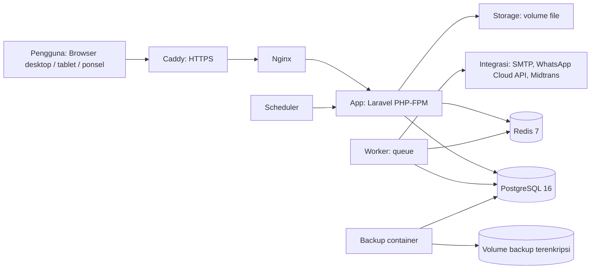

# PETORA — Master Technical Specification (MTS) v2.0

Status: Final untuk implementasi
Produk: PETORA — Integrated Petshop & Pet Care Management System
Model bisnis: Satu entitas bisnis, mendukung banyak cabang (rilis awal: 1 cabang aktif)
Platform: Responsive web application (bukan aplikasi native)
Bahasa utama: Bahasa Indonesia (locale `id`)
Zona waktu tampilan: Asia/Jakarta (WIB). Penyimpanan: UTC.
Mata uang: IDR (Rupiah), format `Rp 1.250.000`

Dokumen ini adalah satu-satunya sumber kebenaran untuk implementasi. Jika ada hal yang tidak tercantum, keputusannya ada di Bagian 0 (Keputusan Teknis). Jika ada pertentangan antar bagian, Bagian 0 yang berlaku.

---

## Daftar Isi

0. Keputusan teknis dan ruang lingkup
1. Ringkasan produk dan prinsip arsitektur
2. Teknologi dan arsitektur sistem
3. Struktur repositori
4. Konfigurasi lingkungan
5. Deployment dan otomasi
6. Peran, RBAC, dan cakupan data
7. Spesifikasi modul
8. Model data
9. Alur bisnis dan mesin status
10. Integrasi pihak ketiga
11. Keamanan dan privasi data
12. UI/UX dan desain visual
13. Non-fungsional, observabilitas, dan backup
14. Pengujian dan kriteria penerimaan
15. Rilis, roadmap, dan Definition of Done
16. Konvensi pengembangan
17. Lampiran: daftar keputusan

---

## 0. Keputusan Teknis dan Ruang Lingkup

Bagian ini menutup seluruh keputusan yang sebelumnya kosong atau belum jelas.

### 0.1 Keputusan utama

| No | Topik | Keputusan | Alasan |
|----|-------|-----------|--------|
| D1 | Cakupan cabang | Model data mendukung multi-cabang sejak awal (setiap transaksi memiliki `branch_id`). Rilis awal dioperasikan dengan 1 cabang aktif ("Pusat"). Penambahan cabang tidak memerlukan perubahan kode. | Spesifikasi awal menyebut multi-cabang; catatan awal menyebut satu cabang. Model multi-cabang mencakup keduanya tanpa biaya tambahan. |
| D2 | Ruang lingkup rilis | Semua 35 modul dispesifikasikan penuh di sini. Pengerjaan dibagi tiga rilis (Bagian 15). Rilis 1 wajib siap deploy produksi. | Menghindari pengerjaan setengah jadi sambil tetap memberi acuan lengkap. |
| D3 | Framework | Laravel 11 (PHP 8.3) | Ekosistem matang untuk ERP dan RBAC. |
| D4 | UI dinamis | Livewire 3 + Alpine.js, styling Tailwind CSS 3 | Sesuai catatan awal; tanpa SPA terpisah sehingga pengembangan lebih ringkas. |
| D5 | Database | PostgreSQL 16 | Relasional, mendukung transaksi, constraint, dan index parsial. |
| D6 | Cache, session, queue | Redis 7 | Session, cache, dan antrean notifikasi. |
| D7 | RBAC | `spatie/laravel-permission` dengan tabel kustom tambahan untuk `branch_access` dan `data_scope` | Dynamic role dan permission sudah teruji. |
| D8 | Format uang | `DECIMAL(15,2)` di database; pembulatan ke rupiah penuh untuk tampilan dan pajak | Mengikuti aturan "gunakan decimal untuk uang". |
| D9 | Nomor transaksi | Format `{KODE_JENIS}/{KODE_CABANG}/{YYYYMM}/{SEQ 6 digit}`, contoh `INV/PST/202611/000125`. Sekuens per cabang dan per jenis dokumen, dikunci dengan `SELECT ... FOR UPDATE`. | Unik, mudah dibaca, aman dari duplikasi. |
| D10 | Pajak | PPN dinonaktifkan secara default, tarif 11% dapat diaktifkan di pengaturan. Mode harga: eksklusif pajak (default) atau inklusif. | Pajak adalah konfigurasi, bukan logika tetap. |
| D11 | Metode pembayaran | Tunai, Transfer Bank, QRIS, Kartu Debit, Kartu Kredit, EDC, Saldo Member, Payment Gateway. Daftar dapat ditambah Super Admin. | Mengakomodasi kebiasaan pembayaran Indonesia. |
| D12 | Pengelolaan stok | Stok dihitung dari `stock_movements` dan disimpan ke tabel saldo `stock_balances` dalam transaksi yang sama. Stok negatif tidak diizinkan secara default (dapat diubah di pengaturan). | Konsisten dan dapat diaudit. |
| D13 | Metode stok keluar | FEFO untuk produk ber-batch dan ber-kedaluwarsa; FIFO untuk produk lain. | Mengurangi barang kedaluwarsa. |
| D14 | Poin loyalty | Default: 1 poin per Rp 10.000 belanja; 100 poin dapat ditukar Rp 10.000. Nilai dapat diubah Super Admin. | Angka awal yang wajar; bisa diatur. |
| D15 | Slot grooming | Grid 30 menit, buffer 0 menit default, dapat diatur per layanan. | Sederhana dan cukup untuk operasional. |
| D16 | Kapasitas hotel | Kapasitas dihitung per kamar dan per tanggal. Satu kamar satu hewan kecuali jenis kamar mengizinkan kapasitas lebih (`capacity`). | Mencegah overbooking. |
| D17 | Integrasi pembayaran pertama | Midtrans (Snap) | Umum digunakan di Indonesia. Adapter lain ditambahkan kemudian. |
| D18 | Integrasi WhatsApp pertama | WhatsApp Cloud API (Meta) melalui adapter | Resmi dan stabil. |
| D19 | Email | SMTP, dikonfigurasi di Super Admin | Sesuai spesifikasi. |
| D20 | Autentikasi | Email atau nomor telepon + password. Verifikasi dua langkah TOTP wajib untuk Super Admin dan Admin. Customer opsional. | Keamanan untuk peran berhak akses tinggi. |
| D21 | Kebijakan password | Minimal 10 karakter, kombinasi huruf dan angka, tidak boleh sama dengan 5 password terakhir, hash bcrypt (cost 12). | Standar praktis. |
| D22 | Keamanan login | Kunci 15 menit setelah 5 kali gagal berturut-turut. Sesi idle berakhir 120 menit. | Mengurangi brute force. |
| D23 | Unggahan file | Foto dan dokumen: JPG, PNG, WEBP, PDF; maksimal 5 MB per file. Gambar dikonversi ulang (strip metadata EXIF). | Mencegah file berbahaya dan kebocoran lokasi. |
| D24 | Enkripsi | Kolom catatan medis, diagnosis bebas, dan seluruh kredensial integrasi dienkripsi di tingkat aplikasi (`encrypted` cast, kunci dari `APP_KEY`). | Sesuai kebutuhan keamanan data medis. |
| D25 | Retensi | Audit log disimpan 5 tahun. Data transaksi tidak dihapus permanen. Data medis tidak dihapus saat akun pelanggan dinonaktifkan. | Kepatuhan dan pelacakan. |
| D26 | Hosting | VPS Linux (Ubuntu 24.04 LTS) dengan Docker Compose. Edge HTTPS menggunakan Caddy (sertifikat otomatis). | Sederhana, murah, dan mudah direproduksi. |
| D27 | Deployment | Otomatis melalui GitHub Actions: build image, push ke GitHub Container Registry, lalu deploy ke server dengan skrip dan rollback otomatis. | Sesuai permintaan deploy otomatis. |
| D28 | Bahasa kode | Kode, nama tabel, dan nama kolom dalam Bahasa Inggris; label UI dan pesan ke pengguna dalam Bahasa Indonesia. | Standar industri untuk kode, tetap ramah pengguna. |

### 0.2 Batasan dan pengecualian

- PETORA dirancang untuk satu entitas bisnis. Jika digunakan oleh perusahaan lain yang tidak berada dalam satu organisasi, arsitektur harus dievaluasi ulang (bukan multi-tenant).
- Aplikasi native Android dan iOS tidak dibuat. Seluruh pengalaman mobile melalui web responsif yang dapat dipasang sebagai PWA (manifest dan service worker sederhana, tanpa offline mode pada rilis 1).
- Modul akuntansi berjurnal ganda (double entry) dan konsinyasi masuk Rilis 3.

---

## 1. Ringkasan Produk dan Prinsip Arsitektur

PETORA adalah aplikasi web terintegrasi untuk mengelola operasional pet shop dan pet care: penjualan produk, kasir, persediaan, pembelian, grooming, penitipan hewan, layanan antar jemput, klinik hewan dan rekam medis, keuangan, SDM, loyalty, serta portal pelanggan untuk memantau hewan peliharaan mereka.

### 1.1 Prinsip

1. Satu organisasi, banyak cabang, satu database pusat.
2. Setiap data operasional memiliki `branch_id`.
3. Super Admin mengontrol seluruh sistem, termasuk role, permission, dan integrasi.
4. Semua otorisasi diverifikasi di backend. Tampilan frontend hanya menyembunyikan elemen; bukan pengaman.
5. Semua konfigurasi yang mungkin dibuat melalui halaman Pengaturan. Tidak ada nilai bisnis yang di-hardcode.
6. PETORA tidak bergantung pada layanan pihak ketiga untuk fungsi inti. Pembayaran, WhatsApp, dan email bersifat opsional; jika tidak dikonfigurasi, fungsi inti tetap berjalan.
7. Tidak ada dummy data sebagai pengganti logika bisnis. Seeder hanya berisi master awal (peran, izin, cabang awal, pengaturan default).
8. Jejak audit untuk setiap perubahan penting.

### 1.2 Pengguna dan peran bawaan

| Peran | Tipe | Deskripsi |
|-------|------|-----------|
| Super Admin | Peran sistem terlindungi | Mengelola seluruh sistem, cabang, role, integrasi |
| Admin | Peran sistem terlindungi | Operasional harian sesuai izin yang diberikan |
| Dokter | Peran sistem terlindungi | Layanan medis sesuai penugasan |
| Customer | Peran sistem terlindungi | Pemilik hewan, mengakses portal |

Peran bawaan tidak dapat dihapus dan namanya tidak dapat diubah. Izinnya dapat diatur Super Admin dalam batas yang ditetapkan (Bagian 6.4).

---

## 2. Teknologi dan Arsitektur Sistem

### 2.1 Tumpukan teknologi

| Lapisan | Teknologi | Versi minimal |
|---------|-----------|---------------|
| Bahasa server | PHP | 8.3 |
| Framework | Laravel | 11.x |
| UI reaktif | Livewire | 3.x |
| Interaktivitas ringan | Alpine.js | 3.x |
| Styling | Tailwind CSS | 3.4 |
| Database | PostgreSQL | 16 |
| Cache, session, queue | Redis | 7 |
| Web server | Nginx (php-fpm) di dalam container | 1.25 |
| Edge HTTPS | Caddy | 2.8 |
| Kontainerisasi | Docker, Docker Compose | Compose v2 |
| Grafik | Chart.js (lokal, bukan CDN) | 4.x |
| PDF (struk, laporan) | dompdf | 2.x |
| Excel import/export | maatwebsite/excel | 3.1 |
| RBAC | spatie/laravel-permission | 6.x |
| 2FA | pragmarx/google2fa-laravel | 2.x |
| Backup | spatie/laravel-backup + pg_dump | 9.x |
| Test | Pest | 2.x |
| Analisis statis | Larastan level 6 | 2.x |
| Format kode | Laravel Pint | 1.x |
| Monitoring error | Sentry (opsional, via DSN) | — |
| CI/CD | GitHub Actions | — |

Seluruh aset (font, ikon, Chart.js) dibundel lokal. Tidak ada CDN eksternal pada produksi.

### 2.2 Diagram arsitektur



### 2.3 Lapisan aplikasi

- Presentation: Livewire component dan Blade view. Validasi awal di form.
- Application: Service class per modul (business logic). Dipanggil dari Livewire, controller API internal, atau command.
- Domain: Model Eloquent, enum status, event, dan aturan domain (misalnya `StockPolicy`, `BookingCapacityPolicy`).
- Infrastructure: Repository tidak dibuat secara umum; query kompleks ditempatkan di class `Query` per modul. Adapter integrasi di `app/Integrations`.
- Authorization: Policy Laravel untuk setiap model, diperiksa di service. Scope cabang diterapkan melalui global scope `BranchScope`.

Aturan: business logic tidak boleh berada di komponen Livewire atau Blade.

### 2.4 Multi-cabang dan isolasi data

- Trait `BelongsToBranch` menambahkan kolom `branch_id` dan global scope yang membatasi query ke cabang yang diizinkan untuk pengguna.
- Super Admin dan pengguna dengan `All Branches` melewati scope dengan izin eksplisit `branches.view_all`.
- Master data global (produk, layanan, peran) tidak memiliki `branch_id`. Harga per cabang disimpan di `product_prices` atau `grooming_service_prices` dengan `branch_id` nullable (null = harga global).

---

## 3. Struktur Repositori

Repositori tunggal (monorepo) untuk aplikasi, infrastruktur, dan dokumentasi.

```text
petora/
├── .github/
│   └── workflows/
│       ├── ci.yml                 # lint, analisis statis, test, build image
│       ├── deploy-staging.yml     # deploy otomatis dari branch develop
│       └── deploy-production.yml  # deploy dari tag v*.*.* (manual approval)
├── app/
│   ├── Console/Commands/          # perintah artisan kustom (petora:*)
│   ├── Enums/                     # status dan tipe (enum PHP 8.1+)
│   ├── Events/ Listeners/         # event domain (mis. OrderPaid, StockLow)
│   ├── Exceptions/
│   ├── Integrations/              # adapter: Midtrans, WhatsApp, SMTP, Maps
│   │   ├── Contracts/
│   │   └── Adapters/
│   ├── Models/                    # model Eloquent (dikelompokkan per modul di sub-namespace jika perlu)
│   ├── Modules/                   # kode per modul
│   │   ├── Auth/
│   │   ├── Users/
│   │   ├── Roles/
│   │   ├── Branches/
│   │   ├── Customers/
│   │   ├── Pets/
│   │   ├── Products/
│   │   ├── Inventory/
│   │   ├── Purchasing/
│   │   ├── Pos/
│   │   ├── Grooming/
│   │   ├── Hotel/
│   │   ├── Veterinary/
│   │   ├── Pharmacy/
│   │   ├── Finance/
│   │   ├── Reports/
│   │   └── ...                    # satu folder per modul
│   │       ├── Services/          # business logic
│   │       ├── Livewire/          # komponen UI
│   │       ├── Policies/
│   │       ├── Queries/           # query baca kompleks
│   │       ├── Requests/          # validasi
│   │       └── routes.php
│   ├── Policies/
│   ├── Scopes/                    # BranchScope
│   ├── Support/                   # helper murni (format rupiah, tanggal WIB, nomor dokumen)
│   └── Traits/                    # BelongsToBranch, Auditable
├── bootstrap/
├── config/
│   ├── petora.php                 # konfigurasi bisnis default (pajak, poin, slot)
│   └── ...
├── database/
│   ├── migrations/                # urut per modul, timestamp konsisten
│   ├── seeders/                   # master awal saja (peran, izin, cabang awal, pengaturan)
│   └── factories/
├── docker/
│   ├── app/Dockerfile             # multi-stage: composer, node build, runtime php-fpm
│   ├── nginx/default.conf
│   ├── caddy/Caddyfile
│   ├── postgres/init.sql          # extension (uuid-ossp / pgcrypto) jika diperlukan
│   └── backup/Dockerfile
├── docs/
│   ├── MTS.md                     # dokumen ini
│   ├── ADR/                       # Architecture Decision Record (satu file per keputusan baru)
│   ├── api/                       # dokumentasi endpoint integrasi (jika ada)
│   ├── runbook/                   # prosedur deploy, rollback, restore backup, rotasi kunci
│   └── CHANGELOG.md
├── resources/
│   ├── css/app.css
│   ├── js/app.js
│   ├── lang/id/                   # terjemahan Bahasa Indonesia
│   └── views/
├── routes/
│   ├── web.php
│   ├── console.php
│   └── health.php
├── scripts/
│   ├── setup.sh                   # setup developer pertama kali
│   ├── deploy.sh                  # deploy di server (dipanggil CI)
│   ├── rollback.sh
│   ├── backup-restore.sh          # restore dari backup
│   └── seed-production.sh         # bootstrap Super Admin pertama
├── storage/
├── tests/
│   ├── Feature/                   # per modul
│   ├── Unit/
│   ├── Security/                  # matriks RBAC, isolasi cabang, isolasi customer
│   └── Browser/                   # Playwright / Dusk untuk alur kritis
├── .env.example
├── .env.staging.example
├── .env.production.example
├── compose.yaml                   # dev
├── compose.prod.yaml              # produksi
├── compose.staging.yaml           # staging
├── Makefile                       # perintah umum: make up, make test, make deploy-staging
├── phpstan.neon
├── pint.json
├── composer.json
├── package.json
├── README.md
└── CONTRIBUTING.md
```

Aturan struktur:
- Satu modul = satu folder di `app/Modules`. Modul tidak boleh mengakses `Services` modul lain secara langsung selain melalui kontrak publik (interface di `Contracts` atau event).
- Migrasi diberi nama modul dan urutan: `2026_01_01_000100_create_branches_table.php`.
- Setiap modul wajib memiliki test Feature minimal untuk create, update, delete (atau nonaktif), otorisasi, dan validasi.

---

## 4. Konfigurasi Lingkungan

### 4.1 Lingkungan

| Lingkungan | Tujuan | Sumber deploy |
|------------|--------|---------------|
| local | Pengembangan | `make up` di mesin developer |
| staging | Uji QA dan UAT | branch `develop` (otomatis) |
| production | Operasional | tag `vX.Y.Z` (dengan persetujuan manual) |

### 4.2 Variabel lingkungan (`.env`)

Prinsip: `.env` hanya berisi konfigurasi bootstrap infrastruktur dan secret bootstrap. Kredensial integrasi TIDAK disimpan di `.env`; dikelola melalui halaman Super Admin dan disimpan terenkripsi di database.

| Variabel | Wajib | Contoh | Keterangan |
|----------|-------|--------|------------|
| APP_NAME | ya | PETORA | |
| APP_ENV | ya | production | local, staging, production |
| APP_KEY | ya | base64:... | Kunci enkripsi. Jangan diubah sembarangan (lihat runbook rotasi). |
| APP_DEBUG | ya | false | Wajib `false` di staging dan production |
| APP_URL | ya | https://petora.example.id | |
| APP_LOCALE | ya | id | |
| APP_FALLBACK_LOCALE | ya | id | |
| APP_TIMEZONE | ya | Asia/Jakarta | Tampilan. Penyimpanan tetap UTC. |
| DB_CONNECTION | ya | pgsql | |
| DB_HOST | ya | db | Nama service Compose |
| DB_PORT | ya | 5432 | |
| DB_DATABASE | ya | petora | |
| DB_USERNAME | ya | petora | |
| DB_PASSWORD | ya | — | Dari secret |
| REDIS_HOST | ya | redis | |
| REDIS_PASSWORD | ya | — | Dari secret |
| SESSION_DRIVER | ya | redis | |
| SESSION_LIFETIME | ya | 120 | Menit (sesuai D22) |
| CACHE_STORE | ya | redis | |
| QUEUE_CONNECTION | ya | redis | |
| FILESYSTEM_DISK | ya | local | Atau `s3` jika kebijakan menuntut |
| MAIL_MAILER | tidak | smtp | Default bootstrap; dapat ditimpa dari Super Admin |
| SENTRY_LARAVEL_DSN | tidak | — | Kosong = nonaktif |
| SUPER_ADMIN_NAME | seed | — | Dipakai hanya saat bootstrap pertama |
| SUPER_ADMIN_EMAIL | seed | — | |
| SUPER_ADMIN_PASSWORD | seed | — | Wajib diganti setelah login pertama; tidak disimpan di repo |
| BACKUP_RETENTION_DAILY | tidak | 14 | |
| BACKUP_RETENTION_WEEKLY | tidak | 8 | |
| BACKUP_GPG_RECIPIENT | ya (prod) | ops@petora.example.id | Enkripsi backup |
| TRUSTED_PROXIES | ya (prod) | caddy | |

### 4.3 Konfigurasi bisnis (`config/petora.php` dan tabel `system_settings`)

Nilai default yang dapat diubah Super Admin tanpa deploy:

| Kunci | Default | Keterangan |
|-------|---------|------------|
| tax.enabled | false | PPN aktif/nonaktif |
| tax.rate | 11 | Persen |
| tax.price_mode | exclusive | exclusive / inclusive |
| rounding.mode | rupiah | Pembulatan ke rupiah penuh |
| receipt.number_prefix | INV | |
| loyalty.earn_per_amount | 10000 | Rupiah per 1 poin |
| loyalty.redeem_points | 100 | |
| loyalty.redeem_value | 10000 | Nilai rupiah per penukaran |
| stock.allow_negative | false | |
| stock.issue_method_default | fifo | fifo / fefo |
| stock.low_threshold_default | 5 | Unit |
| grooming.slot_minutes | 30 | |
| grooming.buffer_minutes | 0 | |
| hotel.checkout_time | 12:00 | WIB |
| hotel.late_fee_per_hour | 0 | 0 = nonaktif |
| refund.requires_approval | true | |
| void.requires_approval | true | |
| cash.variance_tolerance | 0 | Rupiah |
| security.lockout_attempts | 5 | |
| security.lockout_minutes | 15 | |
| security.idle_timeout_minutes | 120 | |
| security.password_history | 5 | |
| upload.max_mb | 5 | |
| audit.retention_years | 5 | |

Pengaturan yang mengubah perhitungan keuangan dicatat di audit log beserta nilai lama dan baru.

---

## 5. Deployment dan Otomasi

### 5.1 Prinsip

- Build sekali, deploy banyak kali: image Docker dibangun di CI dan diberi tag git SHA dan semver.
- Deploy berbasis image, bukan `git pull` di server.
- Migrasi database berjalan sebagai langkah terpisah dengan lock, sebelum container baru menerima trafik.
- Setiap deploy memiliki health check dan rollback otomatis.
- Tidak ada secret di repositori. Secret di GitHub Environments dan file `.env` di server (permission 600).

### 5.2 Alur CI

Pada setiap pull request ke `develop` atau `main`:
1. Install dependensi dengan cache.
2. Pint (`pint --test`) harus lulus.
3. Larastan level 6 harus lulus.
4. Pest (unit, feature, security) harus lulus dengan coverage minimal 70% pada `app/Modules/*/Services`.
5. Audit dependensi: `composer audit` dan `npm audit --omit=dev`. Kerentanan kritis memblokir merge.
6. Build image Docker (tanpa push).

Pada merge ke `develop`:
1. Ulangi langkah di atas.
2. Build dan push image ke `ghcr.io/<org>/petora:<sha>` dan `:develop`.
3. Deploy otomatis ke staging.
4. Jalankan smoke test (`scripts/smoke.sh`) dan Playwright untuk alur kritis.

Pada tag `vX.Y.Z` di `main`:
1. Build dan push image `:X.Y.Z` dan `:latest`.
2. Menunggu persetujuan environment `production` (GitHub Environments: required reviewer).
3. Deploy ke production dengan skrip yang sama.

### 5.3 Alur deploy di server (`scripts/deploy.sh`)

Skrip ini dipanggil oleh CI melalui SSH dengan argumen `IMAGE_TAG`.

1. Simpan tag image yang sedang berjalan ke `.deploy/previous_tag`.
2. Pull image baru.
3. Jalankan `php artisan down --retry=60` pada container app lama (mode maintenance singkat).
4. Jalankan `php artisan migrate --force` dalam container sementara (one-off), dengan lock advisory PostgreSQL.
5. Jalankan `php artisan config:cache route:cache view:cache event:cache`.
6. Recreate container `app`, `worker`, `scheduler` dengan `docker compose -f compose.prod.yaml up -d`.
7. Health check `GET /up` dan `GET /health` (detail, dengan token internal) selama maksimal 90 detik.
8. Jika gagal: jalankan `scripts/rollback.sh` yang mengembalikan image sebelumnya. Migrasi yang bersifat destruktif tidak boleh ada dalam satu rilis; setiap migrasi harus backward compatible (expand-contract).
9. Jika sukses: `php artisan up`, kirim notifikasi ke kanal deploy, tulis entri ke `docs/CHANGELOG.md` otomatis dari tag.

### 5.4 Rollback

- Rollback kode: `scripts/rollback.sh <tag>` (dalam hitungan detik, karena image sudah ada).
- Rollback data: hanya dengan restore backup (Bagian 13.4). Karena migrasi bersifat expand-contract, rollback kode tidak memerlukan rollback skema.

### 5.5 Setup server pertama kali

1. Siapkan VPS Ubuntu 24.04 LTS, buat user `deploy` dengan akses SSH key, nonaktifkan login password.
2. Pasang Docker Engine dan Compose plugin.
3. Firewall (ufw): izinkan 22 (dibatasi IP), 80, 443. Lainnya ditutup.
4. Clone repositori hanya untuk folder `compose.prod.yaml`, `docker/`, `scripts/`, dan `.env.production`.
5. Jalankan `scripts/bootstrap-server.sh` (membuat direktori volume, mengatur permission, mengecek Docker).
6. `docker compose -f compose.prod.yaml up -d db redis` lalu jalankan `scripts/first-deploy.sh` yang melakukan migrasi, seed master, dan membuat Super Admin dari variabel bootstrap.
7. Login sebagai Super Admin, ganti password, aktifkan 2FA, lalu hapus variabel `SUPER_ADMIN_PASSWORD` dari `.env`.

### 5.6 Compose produksi (ringkasan)

Service: `caddy` (80/443), `web` (nginx), `app` (php-fpm), `worker` (queue:work, 2 replika), `scheduler` (schedule:work), `db` (PostgreSQL 16, volume terpisah), `redis` (dengan password dan appendonly), `backup` (cron harian).

Aturan:
- Hanya `caddy` yang mengekspos port ke host.
- `db` dan `redis` hanya di jaringan internal.
- Setiap service memiliki `restart: unless-stopped`, `healthcheck`, dan batas memori.
- Volume bernama: `pgdata`, `redisdata`, `storage`, `backups`, `caddy_data`.

### 5.7 Otomasi tambahan

- Renovate untuk pembaruan dependensi dengan PR mingguan.
- Dependabot untuk GitHub Actions.
- Pemeriksaan sertifikat dan kesehatan server melalui monitor eksternal (UptimeRobot atau setara) ke `/up`.

---

## 6. Peran, RBAC, dan Cakupan Data

### 6.1 Model otorisasi

Otorisasi dihitung dari tiga lapis:
1. Permission: apa yang boleh dilakukan (view, create, update, delete, approve, reject, export, print, import, refund, manage).
2. Cakupan cabang (`branch scope`): cabang mana yang dapat diakses.
3. Cakupan data (`data scope`): data mana di dalam cabang tersebut.

Hak akses efektif = permission pada modul AND cabang diizinkan AND data scope cocok.

### 6.2 Permission

Format kunci: `{modul}.{aksi}`, contoh `pos.refund`, `inventory.adjust`, `medical_records.view`.

Aksi standar: `view`, `create`, `update`, `delete`, `approve`, `reject`, `export`, `print`, `import`, `refund`, `manage`.

Setiap modul hanya mendeklarasikan aksi yang relevan. Daftar lengkap permission didefinisikan di `database/seeders/PermissionSeeder.php` dan dibaca oleh matriks peran di UI.

### 6.3 Cakupan data

| Scope | Arti |
|-------|------|
| all_branches | Semua cabang |
| assigned_branches | Cabang yang ditugaskan |
| own | Data yang dibuat atau dimiliki pengguna |
| assigned_records | Data yang ditugaskan kepada pengguna (mis. booking untuk groomer) |
| department | Data pada departemen pengguna |

### 6.4 Batasan peran bawaan

| Peran | Boleh | Tidak boleh |
|-------|-------|-------------|
| Super Admin | Semua modul, semua cabang, role, integrasi, pengaturan | Dihapus oleh peran lain; dinonaktifkan jika tidak ada Super Admin aktif lain |
| Admin | Mengelola modul sesuai izin; mengelola pengguna dan role di bawah batas delegasinya | Mengambil alih Super Admin; memberi permission di luar yang dimilikinya; mengubah pengaturan integrasi kredensial |
| Dokter | Rekam medis dan resep pada pasien yang ditugaskan; riwayat medis | Keuangan, administrasi sistem, pengaturan; melihat data medis di luar penugasan |
| Customer | Profil sendiri, hewan sendiri, booking, transaksi sendiri, rekam medis yang diizinkan | Data pelanggan lain; mengubah rekam medis |

Batas delegasi Admin: Admin hanya dapat memberikan permission yang ia miliki sendiri dan hanya untuk cabang yang ia miliki aksesnya.

### 6.5 Peran custom

Super Admin dapat membuat peran dari halaman Role & Permission:
- Membuat, mengubah nama dan deskripsi, menduplikasi, menonaktifkan, menghapus (hanya jika tidak ada pengguna aktif; jika ada, ditolak dengan pesan jelas).
- Mengatur permission dengan matriks (modul x aksi).
- Mengatur cabang dan data scope.
- Setiap perubahan dicatat di audit log.

Peran contoh yang disiapkan sebagai template (tidak aktif sampai diaktifkan Super Admin): Owner, General Manager, Branch Manager, Supervisor, Cashier, Groomer, Pet Hotel Staff, Inventory Staff, Warehouse Staff, Purchasing Staff, Accountant, Customer Service, Driver, Veterinary Assistant, Marketing, Auditor.

### 6.6 Aturan keamanan peran

- Peran custom tidak boleh memberi permission `manage` pada `roles` atau `integrations` kecuali oleh Super Admin.
- Tidak ada peran yang dapat memberi permission yang tidak dimilikinya (anti privilege escalation), diverifikasi di backend.
- Setiap pengguna minimal memiliki satu peran aktif.

---

## 7. Spesifikasi Modul

Setiap modul memuat: tujuan, rilis, fitur, aturan bisnis, dan izin utama. Layar dan komponen UI mengikuti Bagian 12.

Legenda rilis: R1 = Rilis 1 (wajib produksi), R2 = Rilis 2, R3 = Rilis 3.

### 7.1 Dashboard (R1)

Tujuan: ringkasan operasional sesuai cabang dan peran pengguna.

Fitur:
- Omzet hari ini, minggu ini, bulan ini; total transaksi.
- Total pelanggan dan total hewan terdaftar.
- Booking hari ini dan status ringkasnya.
- Grooming yang sedang berjalan.
- Okupansi hotel (R2).
- Produk stok menipis dan mendekati kedaluwarsa.
- Pendapatan per jenis layanan; produk dan layanan terlaris.
- Grafik penjualan dan pengeluaran (30 hari terakhir, dapat diubah ke 7/30/90 hari).
- Performa cabang (khusus pengguna dengan akses lintas cabang).
- Aktivitas terbaru (dari audit log yang dapat diakses pengguna).

Aturan:
- Dashboard Super Admin menampilkan seluruh cabang dengan filter cabang.
- Dashboard pengguna cabang hanya menampilkan cabang yang diizinkan.
- Angka dihitung dari query ringkasan yang di-cache 60 detik per cabang dan per pengguna; cache dibersihkan saat transaksi relevan terjadi.

Izin: `dashboard.view`; widget tertentu memerlukan izin modul terkait.

### 7.2 User Management (R1)

Fitur: daftar, tambah, ubah, nonaktifkan pengguna; reset password oleh Admin (dengan tautan sekali pakai); atur peran dan cabang; lihat log login.

Aturan:
- Pengguna dinonaktifkan, tidak dihapus.
- Pengguna tidak dapat menonaktifkan dirinya sendiri.
- Pengguna terakhir dengan peran Super Admin aktif tidak dapat dinonaktifkan.
- Setiap pengguna karyawan terhubung dengan satu data `employees` (Staff Management).
- Pengguna customer dibuat melalui registrasi portal atau oleh staf di modul Customer.

Izin: `users.view|create|update|manage`.

### 7.3 Role & Permission (R1)

Lihat Bagian 6. Fitur: create, edit, delete (dengan validasi), duplicate, assign permission, assign user, branch assignment, status aktif/nonaktif, audit log, pencarian, filter, detail role.

Izin: `roles.view|create|update|delete|manage`. Hanya Super Admin yang dapat mengubah peran bawaan, dan hanya batas izin yang diperbolehkan (peran bawaan tidak bisa dihapus).

### 7.4 Branch Management (R1)

Fitur: tambah cabang, ubah informasi, aktif/nonaktif, kode cabang (otomatis, 3–4 huruf, unik, tidak dapat diubah setelah dibuat), nama, alamat, telepon, email, jam operasional, hari libur, gudang utama, penugasan karyawan, layanan yang tersedia, harga per cabang (jika diizinkan), laporan performa cabang.

Aturan:
- Cabang nonaktif tidak dapat menerima transaksi baru tetapi data historisnya tetap dapat dilihat.
- Setiap cabang wajib memiliki minimal satu gudang.
- Setiap transaksi wajib memiliki `branch_id`; tidak ada transaksi tanpa cabang.
- Transfer stok antar cabang dicatat sebagai transfer (Bagian 7.7).

Izin: `branches.view|create|update|manage`, `branches.view_all`.

### 7.5 Customer Management (R1)

Fitur: registrasi, nomor pelanggan otomatis (`CUS-000001`), nama, telepon, email, alamat (lebih dari satu), tanggal lahir, jenis kelamin (opsional), catatan internal, membership (R2), loyalty points, histori pembelian, histori booking, histori pembayaran, status (aktif, nonaktif, blacklist), blacklist dengan alasan dan audit.

Aturan:
- Telepon dapat digunakan untuk pencarian dan dinormalisasi ke format `62xxxxxxxxxx`; unik per organisasi jika diisi. Telepon bukan kunci database.
- Pelanggan blacklist tidak dapat membuat booking baru; transaksi kasir memerlukan persetujuan Admin.
- Data pelanggan yang dinonaktifkan tetap menyimpan riwayat medis dan transaksi.
- Pencarian pelanggan cepat (kurang dari 300 ms pada 100.000 data) menggunakan index trigram pada nama dan telepon.

Izin: `customers.view|create|update|delete|export|import`, `customers.blacklist`.

### 7.6 Pet Management (R1)

Fitur: data hewan (lihat daftar di bawah), foto, riwayat vaksin, pengobatan, grooming, hotel, catatan perilaku, catatan medis.

Data hewan: `pet_code` (otomatis, `PET-000001`), nama, jenis (anjing, kucing, kelinci, burung, reptil, lainnya), ras, jenis kelamin, tanggal lahir, umur (dihitung otomatis), berat (riwayat berat), warna, foto, status steril, alergi (daftar), kondisi khusus, catatan perilaku.

Aturan:
- Satu pelanggan dapat memiliki banyak hewan; satu hewan dapat memiliki beberapa pemilik yang diizinkan melalui `pet_owners`, dengan satu pemilik utama (`is_primary`).
- Perubahan kepemilikan utama hanya oleh Admin atau Super Admin dan dicatat.
- Hewan yang sudah mati ditandai `deceased` (dengan tanggal) dan tidak menerima booking baru.
- Alergi dan kondisi khusus ditampilkan di setiap layanan (grooming, hotel, klinik) sebagai peringatan.

Izin: `pets.view|create|update|delete`.

### 7.7 Product Management & Inventory & Warehouse (R1)

Produk:
- Data: nama, SKU (unik), barcode (EAN-13/Code128, unik, opsional), kategori, brand, deskripsi, foto, varian (ukuran, warna, dll.), berat, satuan dasar, supplier utama, status (aktif, nonaktif), konsinyasi (R3), `track_batch` (bool), `track_expiry` (bool).
- Harga: harga modal (cost), harga jual, harga grosir (dengan minimum qty), harga minimum (batas diskon), harga per cabang (opsional).
- Fitur: import/export Excel, bulk update harga dan kategori, duplikasi, riwayat perubahan harga, aktif/nonaktif.

Aturan harga:
- Harga minimum: diskon tidak boleh membuat harga di bawah harga minimum kecuali dengan persetujuan Admin.
- Perubahan harga disimpan di `product_price_histories` dengan siapa, kapan, nilai lama, nilai baru.

Inventory:
- Stok per gudang, per varian, dan per batch (jika `track_batch`).
- Jenis pergerakan (`stock_movements.type`): `purchase_in`, `sale_out`, `sale_return_in`, `purchase_return_out`, `adjustment_in`, `adjustment_out`, `transfer_out`, `transfer_in`, `damage_out`, `lost_out`, `opname_adjust`, `service_consume_out` (pemakaian obat atau bahan layanan).
- Stock opname: buat sesi, input hasil hitung, sistem menghitung selisih, persetujuan, lalu adjustment otomatis.
- Stock transfer: status `draft → sent → received` (atau `cancelled` sebelum `sent`). Stok keluar saat `sent`, masuk saat `received`. Selisih penerimaan dicatat.
- Batas minimum per produk dan per cabang; memicu notifikasi stok menipis.
- Expiry: peringatan 60 hari sebelum kedaluwarsa (dapat diatur).
- Stock card: riwayat per produk per gudang dengan saldo berjalan.

Aturan wajib:
- Tidak ada perubahan langsung pada `stock_balances` tanpa `stock_movements`.
- Setiap perubahan stok berjalan dalam satu transaksi database dengan lock baris pada saldo.
- Stok keluar mengikuti metode FEFO/FIFO sesuai produk.
- Barang rusak dan hilang memerlukan alasan dan foto (opsional, direkomendasikan).

Warehouse:
- Data gudang: nama, kode, cabang, alamat, status, gudang utama (satu per cabang).

Izin: `products.*`, `inventory.view|adjust|opname|transfer|approve_transfer`, `warehouses.manage`.

### 7.8 POS & Sales (R1)

Fitur: transaksi produk, layanan, paket, dan gabungan dalam satu order; pencarian barcode dan SKU; keranjang; harga otomatis; diskon nominal dan persentase; voucher; harga member (R2); pajak dan biaya tambahan; DP dan pembayaran bertahap; multiple payment; cetak struk (PDF dan thermal); riwayat; pembatalan dengan otorisasi; refund dengan persetujuan; retur produk; shift kasir (buka, cash in, cash out, tutup kas, selisih); audit transaksi.

Alur order:
1. Kasir membuka shift (satu shift aktif per kasir per cabang).
2. Kasir membuat order baru (`draft`). Item ditambah dari produk, layanan grooming, atau layanan klinik yang sudah selesai dan belum ditagih.
3. Diskon dan voucher diterapkan. Diskon di atas batas peran memerlukan persetujuan Admin (PIN approval).
4. Pembayaran: satu atau beberapa pembayaran. Status order menjadi `partially_paid` atau `paid`.
5. Saat `paid`, stok keluar dan poin loyalty ditambahkan. Order menjadi `completed` setelah struk dicetak atau setelah diserahkan (opsional).

Aturan:
- Order yang sudah `paid` tidak dapat diedit. Koreksi harus melalui refund dan order baru.
- Pembatalan order hanya dimungkinkan sebelum pembayaran pertama; dengan otorisasi (`pos.void`).
- Refund memerlukan permission `pos.refund` dan persetujuan (dapat ditentukan oleh pengaturan `refund.requires_approval`).
- Retur produk membuat `sales_returns` dan `stock_movements` (`sale_return_in`), serta refund sesuai kebijakan.
- Tutup kas: selisih dihitung dari kas sistem dan kas fisik. Selisih di atas `cash.variance_tolerance` dicatat dan memerlukan catatan.
- Kas yang sudah ditutup tidak dapat diubah.
- Semua nominal disimpan sebagai `DECIMAL(15,2)`; pembulatan mengikuti pengaturan.

Izin: `pos.view|create|discount|void|refund|approve|cash_manage|cash_close|print`.

### 7.9 Purchasing & Supplier (R1)

Supplier: data (nama, kontak, alamat, NPWP opsional, syarat pembayaran, status), riwayat pembelian, analisis harga.

Pembelian:
- Purchase Request (opsional) → Purchase Order → persetujuan PO (sesuai ambang nominal) → penerimaan barang (`goods_receipts`, parsial diizinkan) → supplier invoice → pembayaran supplier.
- Status PO: `draft → pending_approval → approved → partially_received → received → closed`; `cancelled` sebelum penerimaan pertama.
- Pencocokan 3 arah: PO, penerimaan, dan invoice. Selisih ditandai dan memerlukan persetujuan.
- Penerimaan menghasilkan `stock_movements` (`purchase_in`) dan memperbarui harga modal rata-rata tertimbang (weighted average cost) per produk.
- Retur pembelian (R2): membuat `purchase_return_out`.

Izin: `suppliers.*`, `purchasing.create|approve|receive|pay`.

### 7.10 Grooming (R1)

Master layanan: nama, kategori, harga berdasarkan ukuran hewan (kecil, sedang, besar, extra large) dan opsional ras, durasi, add-on, paket grooming.

Alur status booking grooming:
`pending → confirmed → checked_in → in_progress → quality_check → completed → paid`
Cabang alternatif: `cancelled` (sebelum `checked_in`), `no_show` (setelah waktu lewat 15 menit dari jadwal dan belum check-in).

Fitur: kalender jadwal per groomer, penugasan groomer, check-in, checklist grooming (format terstruktur: item ceklis per layanan), catatan kondisi awal, foto sebelum dan sesudah (maksimal 6 per sesi), quality control (lulus atau perlu perbaikan), check-out, pembayaran lewat POS, komisi groomer (R2), riwayat.

Aturan:
- Booking tidak boleh bertabrakan dengan jadwal groomer; sistem memvalidasi di backend dengan lock.
- Groomer hanya melihat jadwalnya sendiri (scope `assigned_records`).
- Jika hewan memiliki alergi atau kondisi khusus, layanan menampilkan peringatan sebelum check-in dan tercatat di sesi.

Izin: `grooming.view|create|update|assign|checkin|qc|pay|manage`.

### 7.11 Booking (R1, lintas modul)

Booking adalah reservasi umum untuk grooming, konsultasi klinik, dan (R2) hotel, daycare, transport, home grooming.

Fitur: kalender (tampilan hari, minggu, bulan; responsif), pencarian slot, konfirmasi, pembatalan dengan alasan, reschedule (dicatat), reminder.

Aturan:
- Booking dari portal customer masuk status `pending` dan memerlukan konfirmasi staf, kecuali pengaturan auto-confirm aktif.
- Kapasitas dicek dalam transaksi dengan lock pada slot/kamar.
- Reminder H-1 dan 1 jam sebelum jadwal (notifikasi internal, email, dan WhatsApp jika dikonfigurasi).

Izin: `bookings.view|create|update|confirm|cancel`.

### 7.12 Pet Hotel & Daycare (R2)

Fitur: data kamar (nomor, jenis, kapasitas, status), jenis kamar, harga per malam dan per jam (opsional), booking, kalender okupansi, check-in, check-out, pindah kamar, perpanjangan, jadwal makan, minum, obat (dengan integrasi stok dan farmasi), aktivitas harian, dokumentasi, catatan kesehatan, biaya tambahan, biaya keterlambatan, pembayaran, riwayat.

Aturan:
- Sistem tidak menerima reservasi yang melebihi kapasitas kamar pada tanggal manapun dalam periode booking (diperiksa dengan lock).
- Check-out setelah `hotel.checkout_time` dikenakan biaya keterlambatan per jam sesuai pengaturan.
- Pemberian obat di hotel mengurangi stok obat dan tercatat di `hotel_activity_logs` dengan dokter atau staf pemberi.
- Daycare memakai kapasitas harian per cabang (`daycare_capacity`).

Izin: `hotel.*`, `daycare.*`.

### 7.13 Transport (R2)

Fitur: data kendaraan, data driver, booking transport, alamat jemput dan tujuan (dengan Google Maps jika dikonfigurasi, jika tidak input manual), jadwal, penugasan driver, tarif (per jarak atau tetap), biaya tambahan, status perjalanan (`requested → assigned → picked_up → delivered → completed`, `cancelled`), bukti penjemputan dan pengantaran (foto), histori.

Aturan: tarif dihitung saat booking dan disimpan sebagai snapshot.

Izin: `transport.*`.

### 7.14 Home Grooming (R2)

Fitur: booking, alamat, jadwal, groomer, work order, estimasi biaya perjalanan (tarif per jarak), status kunjungan, checklist grooming, dokumentasi, pembayaran, komisi, riwayat.

Aturan: alur status sama dengan grooming studio dengan tambahan `on_the_way` dan `arrived`.

Izin: `home_grooming.*`.

### 7.15 Veterinary Management (R1)

Fitur: registrasi pasien (hewan) dan pemilik, jadwal konsultasi, antrean klinik (nomor antrean harian per cabang), pemeriksaan, anamnesis, pemeriksaan fisik, tanda vital (suhu, detak jantung, respirasi, berat), diagnosis, SOAP, treatment plan, resep, tindakan medis, vaksinasi, laboratorium (permintaan dan hasil sebagai lampiran), rawat inap (R2), catatan anestesi, persetujuan tindakan (dengan tanda tangan digital sederhana: centang persetujuan + nama + waktu), kontrol lanjutan (pengingat), tagihan klinik (dibayar lewat POS).

Aturan:
- Kunjungan medis (`medical_visits`) dibuat oleh dokter dan memiliki status `draft` dan `final`.
- Setelah `final`, isi kunjungan tidak dapat diubah. Revisi membuat entri di `medical_record_revisions` berisi snapshot sebelumnya, dokter pembuat revisi, alasan revisi, dan waktu.
- Dokter hanya dapat membuat kunjungan untuk pasien yang berada dalam penugasannya atau pasien yang sedang dalam antrean kliniknya.

Izin: `veterinary.*`, `medical_records.view|create|update|finalize` (hanya dokter).

### 7.16 Medical Records (R1)

Fitur: riwayat medis lengkap per hewan (vaksin, pengobatan, tindakan, lab, resep, kontrol), tampilan kronologis, pencarian, ekspor PDF, akses customer (hanya bagian yang diizinkan).

Aturan:
- Dokter yang membuat dan yang merevisi tercatat.
- Data medis tidak dapat diubah oleh customer.
- Customer hanya melihat rekam medis yang ditandai `visible_to_owner = true` oleh dokter saat finalisasi (default true untuk vaksin, resep, dan kontrol; default false untuk catatan internal dokter).
- Data medis tidak dihapus saat akun pelanggan dinonaktifkan.
- Catatan diagnosis dan catatan internal dienkripsi (D24).

Izin: `medical_records.view|export`; customer melalui portal.

### 7.17 Pharmacy & Medicine (R1)

Fitur: master obat (kategori, satuan, dosis standar, jenis: obat, vaksin, suplemen), batch, kedaluwarsa, stok obat (menggunakan modul Inventory), resep (dibuat dokter), pengeluaran obat (dari resep), retur obat, peringatan kedaluwarsa, histori pemberian, harga modal dan jual, penggunaan per pasien.

Aturan:
- Obat keras (kategori `prescription`) hanya dapat dikeluarkan dari stok berdasarkan resep final oleh dokter.
- Pengeluaran obat memakai FEFO dan mengurangi stok melalui `stock_movements` (`service_consume_out`).
- Penjualan obat bebas di POS mengikuti aturan produk biasa.

Izin: `pharmacy.view|manage|dispense` (apoteker atau staf farmasi), `prescriptions.create` (dokter).

### 7.18 Membership (R2)

Fitur: master membership (nama, tingkat, masa berlaku, biaya, benefit), keanggotaan pelanggan, perpanjangan, status, diskon member, harga member, saldo (opsional, dalam Rupiah), stamp card.

Aturan: keanggotaan kedaluwarsa mengembalikan pelanggan ke harga umum. Pembayaran keanggotaan lewat POS.

Izin: `membership.*`.

### 7.19 Loyalty (R1 untuk poin; R2 untuk reward)

Fitur R1: akumulasi poin dari transaksi lunas (D14), penukaran poin di POS, riwayat poin (transaksi, penukaran, koreksi, kedaluwarsa).
Fitur R2: reward katalog, stamp card, poin kedaluwarsa (default 12 bulan).

Aturan:
- Poin dihitung dari nilai order setelah diskon, tidak termasuk pajak dan biaya layanan.
- Refund membatalkan poin yang diperoleh dari order tersebut (koreksi tercatat).
- Penukaran poin tidak boleh membuat nilai order negatif.

Izin: `loyalty.view|adjust|manage`.

### 7.20 Promotion (R1 untuk diskon dan voucher; R2 untuk bundling dan B1G1)

Fitur R1: diskon persentase, diskon nominal, voucher kode, periode promo, minimal transaksi, maksimal diskon, batas penggunaan total dan per pelanggan, target cabang, target pelanggan (semua, member, tertentu), status (draft, aktif, nonaktif, berakhir).
Fitur R2: Buy 1 Get 1, bundling.

Aturan:
- Promo tidak dapat digabung kecuali dinyatakan `stackable`.
- Voucher dikonsumsi saat order dibayar, bukan saat ditambahkan ke keranjang.
- Diskon tidak boleh melewati harga minimum produk.

Izin: `promotions.view|create|update|manage|approve`.

### 7.21 Staff Management (R1)

Fitur: data karyawan (nama, NIK opsional, jabatan, departemen, cabang utama, tanggal masuk, status, dokumen, kontak darurat), akun pengguna, peran, jadwal kerja, cuti (R2), komisi (R2), histori aktivitas.

Aturan: karyawan keluar menjadi status `inactive` dan akun pengguna dinonaktifkan. Dokumen karyawan (KTP, kontrak) bersifat rahasia (`hr.documents.view`).

Izin: `staff.*`.

### 7.22 Attendance (R2)

Fitur: absensi via web (check-in/out dengan lokasi cabang opsional dan foto), jadwal kerja shift, rekap, koreksi absensi dengan persetujuan, cuti.

Aturan: absensi tidak dapat diubah setelah periode gaji ditutup; koreksi dicatat.

Izin: `attendance.*`.

### 7.23 Commission (R2)

Fitur: aturan komisi per layanan, produk, staf, cabang; tipe persentase atau nominal; komisi berdasarkan target; perhitungan otomatis; approval; laporan; histori pembayaran.

Aturan:
- Komisi dihitung dengan aturan yang aktif pada saat transaksi (snapshot `rate` dan `type` disimpan di `commission_transactions`).
- Perubahan aturan tidak mengubah komisi yang sudah dihitung.
- Komisi dibayarkan setelah approval periode.

Izin: `commission.view|manage|approve|pay`.

### 7.24 Finance (R1)

Fitur: kas masuk dan keluar per cabang, pendapatan, pengeluaran (kategori), piutang, utang (dari supplier invoice), refund, rekonsiliasi kas (dari tutup shift), saldo kas per cabang (cash accounts: kas laci, bank, e-wallet), laporan arus kas, laporan laba rugi operasional (sederhana).

Aturan:
- Pengeluaran di atas ambang tertentu memerlukan approval.
- Kas dan saldo tidak diubah langsung; setiap perubahan adalah `cash_movements`.

Izin: `finance.view|expense.create|expense.approve|reconcile`.

### 7.25 Accounting (R3)

Fitur: chart of accounts, jurnal umum, jurnal penjualan, pembelian, pembayaran (otomatis dari transaksi), buku besar, neraca saldo, laba rugi, neraca, arus kas, periode akuntansi, tutup buku, audit jurnal.

Aturan:
- Setiap jurnal seimbang (debit = kredit), divalidasi di backend.
- Jurnal yang sudah diposting tidak dapat dihapus; koreksi melalui jurnal pembalik.
- Periode yang sudah ditutup tidak dapat menerima jurnal baru.

Izin: `accounting.*`.

### 7.26 Consignment (R3)

Fitur: supplier konsinyasi, kontrak (periode, komisi), produk titipan, stok titipan (gudang terpisah), penjualan, komisi supplier, settlement (periodik), pembayaran settlement, retur, histori.

Aturan: stok titipan tidak masuk ke nilai aset toko; settlement dihitung dari penjualan yang sudah dibayar.

Izin: `consignment.*`.

### 7.27 Reports & Analytics (R1)

Laporan R1: penjualan (per hari, produk, kasir, cabang, metode bayar), stok (saldo, pergerakan, kedaluwarsa, stok menipis), pembelian, kas (rekonsiliasi shift), booking dan grooming (volume dan okupansi), klinik (kunjungan per dokter dan per jenis layanan), pelanggan (baru, aktif, berulang).
Laporan R2: komisi, absensi, hotel okupansi, transport, membership, loyalty.

Aturan:
- Semua laporan dapat difilter tanggal, cabang, dan (jika berhak) konsolidasi semua cabang.
- Ekspor: Excel dan PDF. Ekspor dicatat di audit log.
- Laporan harus dapat direkonsiliasi: total penjualan laporan sama dengan total pembayaran dan total struk pada periode yang sama (diuji otomatis).
- Laporan berat dijalankan sebagai job antrean dan hasilnya diunduh saat siap.

Izin: `reports.view|export`, per jenis laporan (`reports.sales`, `reports.stock`, dan seterusnya).

### 7.28 Notification (R1)

Fitur: notifikasi dalam aplikasi (lonceng dengan jumlah belum dibaca), notifikasi email, WhatsApp (jika dikonfigurasi). Jenis: booking baru, booking dikonfirmasi, jadwal grooming, check-in hotel, stok menipis, produk kedaluwarsa, PO menunggu persetujuan, pembayaran, pengingat vaksin, pengingat kontrol, aktivitas penting.

Aturan:
- Notifikasi internal tetap berfungsi tanpa email atau WhatsApp.
- Template pesan dikelola Super Admin dengan variabel (`{nama_pelanggan}`, `{nama_hewan}`, `{tanggal}`).
- Pengiriman dilakukan melalui antrean. Gagal kirim dicoba ulang 3 kali dengan jeda eksponensial, lalu dicatat di `integration_logs`.
- Pelanggan dapat berhenti menerima pesan pemasaran (opt-out) dan tetap menerima pesan transaksional.

Izin: `notifications.manage_templates` (Super Admin dan Admin tertentu).

### 7.29 Customer Portal (R1)

Fitur: registrasi, login, lupa kata sandi, profil, profil hewan, booking grooming dan klinik (R1), booking hotel, daycare, transport (R2), katalog produk, keranjang, checkout (pembayaran lewat payment gateway), histori order, histori booking, riwayat vaksin dan medis yang diizinkan, membership (R2), loyalty, voucher, review (R2), pengaduan.

Aturan:
- Customer hanya dapat mengakses datanya sendiri. Setiap query di portal melalui scope `own`.
- Registrasi mengirim email verifikasi. Pendaftaran yang sudah ada (berdasarkan telepon atau email) tidak membuat akun baru tanpa verifikasi kepemilikan.
- Pengaduan masuk ke antrean Customer Service dengan status `open → in_progress → resolved → closed`.
- Pembayaran portal menggunakan Midtrans; status pembayaran diperbarui melalui webhook yang diverifikasi signature-nya.

Izin: sesuai peran Customer (tidak ada izin manajemen).

### 7.30 System Settings (R1)

Fitur: nama bisnis, logo, alamat, telepon, mata uang (IDR tetap), zona waktu, format tanggal, format nomor transaksi, pajak, struk (header, footer, logo), pengaturan cabang, bahasa (Indonesia; Inggris opsional R3), notifikasi, keamanan (lockout, idle timeout, kebijakan password, wajib 2FA), backup (lihat status dan unduh), audit log (pencarian dan ekspor).

Aturan: perubahan pengaturan keuangan dan keamanan dicatat di audit log dengan nilai lama dan baru.

Izin: `settings.view|manage`, `audit.view`, `backup.manage` (Super Admin).

### 7.31 Integration Settings (R1)

Lihat Bagian 10.

Izin: `integrations.view|manage|test` (Super Admin). Admin dapat melihat status tanpa kredensial jika diberi izin `integrations.view`.

---

## 8. Model Data

### 8.1 Konvensi

- Primary key: `id` bigint identity. Kolom `uuid` (opsional, untuk ID publik di URL portal).
- Setiap tabel memiliki `created_at`, `updated_at` (UTC).
- Tabel yang bisa dinonaktifkan memiliki `deleted_at` (soft delete) dan `status`.
- Tabel transaksi memiliki `branch_id`, nomor dokumen unik, `created_by`.
- Kolom uang: `DECIMAL(15,2)`, default 0.
- Foreign key wajib. Index pada setiap foreign key dan kolom pencarian.
- Nama tabel jamak snake_case; nama pivot alfabetis (`role_user` untuk Spatie default atau `user_roles` sesuai Bagian 3).

Catatan: tabel peran dan izin mengikuti struktur `spatie/laravel-permission` (`roles`, `permissions`, `role_has_permissions`, `model_has_roles`) dengan tambahan `branch_access` dan `data_scope` pada tabel `role_branch_scopes`.

### 8.2 Daftar tabel dan kolom kunci

Master dan akses:
- `branches` (id, code unik, name, address, phone, email, operating_hours json, status, main_warehouse_id, timestamps)
- `business_settings` (key unik, value json terenkripsi jika sensitif)
- `system_settings` (key unik, value json, group, updated_by)
- `users` (id, name, email unik nullable, phone unik nullable, password, two_factor_secret terenkripsi, two_factor_confirmed_at, status, last_login_at, locked_until, timestamps)
- `user_password_histories` (user_id, password_hash, created_at)
- `employees` (id, user_id nullable, code, position, department, branch_id, hire_date, status, emergency_contact json)
- `roles`, `permissions`, `role_has_permissions`, `model_has_roles` (Spatie)
- `role_branch_scopes` (role_id, branch_id, data_scope enum)
- `user_branch_access` (user_id, branch_id, is_primary)
- `audit_logs` (id, actor_id, action, auditable_type, auditable_id, old_values json, new_values json, ip, user_agent, created_at) — partisi per bulan jika volume besar.

Pelanggan dan hewan:
- `customers` (id, customer_code unik, user_id nullable, name, phone normalized, email, birth_date, gender, notes_internal, status enum, blacklist_reason, loyalty_points, membership_id nullable, timestamps, deleted_at)
- `customer_addresses` (customer_id, label, address, lat, lng, is_default)
- `pets` (id, pet_code unik, name, species, breed, gender, birth_date, color, is_sterilized, allergies json, special_conditions text, behavior_notes text, status, timestamps)
- `pet_owners` (pet_id, customer_id, is_primary, unique(pet_id, customer_id))
- `pet_weight_histories` (pet_id, weight_kg, measured_at, recorded_by)
- `pet_photos` (pet_id, file_path, uploaded_by)

Produk dan stok:
- `product_categories`, `product_brands`
- `products` (id, sku unik, name, category_id, brand_id, description, base_unit, track_batch, track_expiry, status, supplier_id, weight, timestamps, deleted_at)
- `product_variants` (id, product_id, sku unik, barcode unik nullable, attributes json, cost_price, base_price, min_price, status)
- `product_prices` (variant_id, branch_id nullable, price_type enum(retail, wholesale), min_qty, price, valid_from, valid_to)
- `product_price_histories` (variant_id, field, old_value, new_value, changed_by, changed_at)
- `warehouses` (id, branch_id, code unik per branch, name, is_main, status)
- `stock_balances` (warehouse_id, variant_id, batch_id nullable, qty decimal(15,3), unique(warehouse_id, variant_id, batch_id) — ditangani dengan COALESCE untuk batch null)
- `stock_batches` (id, variant_id, batch_no, expiry_date, received_at)
- `stock_movements` (id, movement_no, type enum, variant_id, warehouse_id, batch_id nullable, qty decimal(15,3) signed, unit_cost decimal(15,2), reference_type, reference_id, reason, created_by, created_at) — append-only
- `stock_adjustments`, `stock_opnames`, `stock_opname_items`, `stock_transfers`, `stock_transfer_items`

Pembelian:
- `suppliers`, `purchase_requests`, `purchase_orders`, `purchase_order_items`, `goods_receipts`, `goods_receipt_items`, `supplier_invoices`, `supplier_payments`, `purchase_returns`, `purchase_return_items`

POS dan keuangan:
- `orders` (id, order_no unik, branch_id, customer_id nullable, cashier_id, cash_session_id, type enum(product, service, package, mixed), status, subtotal, discount_total, tax_total, service_fee, grand_total, paid_total, balance, notes, paid_at, timestamps)
- `order_items` (order_id, item_type enum(product, grooming_service, clinic_service, package, hotel_stay, daycare, transport, home_grooming, membership), reference_id, variant_id nullable, description, qty, unit_price, discount_amount, tax_amount, line_total, commission_snapshot json nullable)
- `order_discounts` (order_id, promotion_id nullable, voucher_id nullable, amount, approved_by nullable)
- `payments` (id, payment_no unik, order_id, method_id, amount, status enum(pending, success, failed, refunded), external_ref nullable, paid_at)
- `payment_methods` (code unik, name, type, is_active)
- `payment_allocations` (payment_id, order_id, amount) — memungkinkan satu pembayaran mengalokasikan ke lebih dari satu order jika diperlukan (default satu-ke-satu)
- `refunds`, `refund_items`
- `cash_sessions` (id, branch_id, cashier_id, opened_at, opening_amount, closed_at, expected_amount, counted_amount, variance, status, closed_by)
- `cash_movements` (id, cash_session_id, type enum(cash_in, cash_out, sale, refund, adjustment), amount, reason, created_by)
- `sales_returns`, `sales_return_items`, `receipts` (order_id, format enum(pdf, thermal), printed_at)
- `expenses` (id, branch_id, category_id, amount, description, status, approved_by, paid_at)
- `cash_accounts` (id, branch_id, name, type enum(cash, bank, ewallet), balance_cache, status) — saldo dihitung dari movement
- `accounts_receivable`, `accounts_payable` (view/ringkasan dari invoice dan order)

Grooming dan booking:
- `grooming_services` (id, code, name, category, duration_minutes, base_price, status)
- `grooming_service_prices` (service_id, pet_size enum, breed_id nullable, branch_id nullable, price)
- `grooming_packages`, `grooming_package_items`
- `grooming_addons`
- `bookings` (id, booking_no unik, branch_id, customer_id, pet_id, service_type enum(grooming, clinic, hotel, daycare, transport, home_grooming), resource_id nullable, assigned_user_id nullable, starts_at, ends_at, status, source enum(staff, portal), notes, cancelled_reason, timestamps)
- `grooming_sessions` (id, booking_id, status, checked_in_at, started_at, qc_at, qc_result enum(pass, rework), completed_at, initial_condition_notes)
- `grooming_checklists`, `grooming_checklist_items` (pemisahan agar konfigurasi item bisa diatur)
- `grooming_photos` (session_id, phase enum(before, after), file_path)
- `grooming_notes` (session_id, note, created_by)

Hotel dan daycare (R2):
- `hotel_room_types` (id, name, capacity, price_per_night, price_per_hour nullable, branch_id)
- `hotel_rooms` (id, branch_id, room_type_id, number, status)
- `hotel_pricing` (room_type_id, season_start, season_end, price)
- `hotel_bookings`, `hotel_stays`, `hotel_checkins`, `hotel_checkouts`, `hotel_care_schedules`, `hotel_activity_logs`, `hotel_additional_charges`
- `daycare_bookings` dengan kapasitas dari `daycare_capacities` (branch_id, date, capacity)

Klinik dan medis (R1):
- `veterinary_appointments` (id, booking_id nullable, pet_id, doctor_id, queue_no, queue_date, status, timestamps)
- `medical_visits` (id, visit_no, pet_id, doctor_id, branch_id, appointment_id nullable, status enum(draft, final), anamnesis, physical_exam, vital_signs json, diagnosis_text encrypted, soap json encrypted, treatment_plan encrypted, finalized_at, finalized_by, timestamps)
- `medical_examinations`, `medical_diagnoses` (kode ICD-10 veteriner opsional), `medical_treatments`, `medical_procedures`, `medical_lab_tests`, `medical_lab_results` (file lampiran), `medical_vaccinations` (vaccine_id, batch_no, given_at, next_due_at), `medical_consents` (procedure, consent_text, agreed_by, agreed_at, agent_name)
- `medical_prescriptions` (id, visit_id, doctor_id, status, issued_at), `medical_prescription_items` (product_variant_id, dose, frequency, duration, qty)
- `medical_record_revisions` (id, visit_id, revised_by, reason, previous_snapshot json encrypted, revised_at)
- `medical_visibility` (visit_id, field_key, visible_to_owner boolean) — atau kolom flag per item

Farmasi: `medicine_categories`, `medicines` (relasi ke `product_variants` untuk stok), `medicine_batches` (melalui `stock_batches`), `medicine_dispensations` (prescription_item_id, qty, dispensed_by, dispensed_at)

Keanggotaan dan loyalty (R1 untuk loyalty):
- `loyalty_accounts` (customer_id, points_balance, lifetime_points)
- `loyalty_transactions` (id, customer_id, type enum(earn, redeem, adjust, expire, reversal), points, order_id nullable, reason, created_at)
- `membership_plans`, `customer_memberships`, `rewards`, `reward_redemptions`, `stamp_cards`

Promosi:
- `promotions` (id, name, type enum(percent, amount, b1g1, bundle), value, starts_at, ends_at, min_transaction, max_discount, usage_limit, usage_count, per_customer_limit, branch_scope json, customer_scope enum, stackable boolean, status)
- `promotion_conditions`, `promotion_usages` (promotion_id, order_id, customer_id, used_at)
- `vouchers` (code unik, promotion_id, status, used_at, used_order_id)

Karyawan dan komisi (R2 untuk absensi dan komisi):
- `work_schedules`, `attendance`, `leave_requests`, `commission_rules`, `commission_transactions`, `commission_payouts`

Keuangan dan akuntansi (R3 untuk akuntansi):
- `chart_of_accounts`, `accounting_periods`, `journal_entries`, `journal_entry_lines`

Konsinyasi (R3):
- `consignment_suppliers`, `consignment_contracts`, `consignment_items`, `consignment_stock`, `consignment_sales`, `consignment_settlements`, `consignment_settlement_items`

Notifikasi dan integrasi:
- `notifications` (id, user_id nullable, customer_id nullable, type, title, body, data json, read_at, created_at)
- `notification_templates` (code unik, channel enum(in_app, email, whatsapp), subject, body, is_active)
- `integration_providers` (code unik: midtrans, whatsapp_cloud, smtp, google_maps, cloud_storage, custom_webhook; name; capabilities json; status)
- `integration_configurations` (provider_id, branch_id nullable, environment enum(sandbox, production), credentials_encrypted text, config json, is_enabled, last_tested_at, last_test_status)
- `integration_logs` (id, provider_id, direction enum(outbound, inbound_webhook), event, status, http_status, error_summary, payload_redacted json, created_at)
- `file_attachments` (id, attachable_type, attachable_id, disk, path, mime, size, sha256, uploaded_by, created_at)
- `system_backups` (id, type, file_path, size, status, checksum, created_at)

Sistem:
- `failed_jobs`, `jobs`, `job_batches`, `cache`, `sessions` (standar Laravel)

### 8.3 Constraint penting

- `stock_movements`: tidak ada update dan delete di level aplikasi (enforce dengan trigger PostgreSQL yang menolak UPDATE/DELETE).
- `payments`, `orders` dengan status paid: trigger menolak perubahan kolom uang setelah `paid_at` terisi.
- `medical_visits` dengan status final: trigger menolak update isi klinis; revisi melalui `medical_record_revisions`.
- `cash_sessions` yang `closed`: trigger menolak update kolom kas.
- `bookings`: exclusion constraint PostgreSQL (`EXCLUDE USING gist`) pada (`resource_id`, `tstzrange(starts_at, ends_at)`) untuk resource yang tidak boleh tumpang tindih (groomer, ruang, kamar). Ini lapisan pengaman tambahan selain lock aplikasi.
- `hotel_stays`: exclusion constraint per kamar pada rentang tanggal.
- Index pencarian: trigram (`pg_trgm`) pada `customers.name` dan `customers.phone`; index unik parsial untuk `products.barcode` yang tidak null.

Trigger dan constraint ini dibuat di migrasi tersendiri dengan nama `enforce_*`.

---

## 9. Alur Bisnis dan Mesin Status

### 9.1 Order (POS)

```text
draft ──► open ──► partially_paid ──► paid ──► completed
  │         │             │
  └─► cancelled ◄────────┘ (hanya sebelum pembayaran pertama, dengan otorisasi)
paid ──► partially_refunded ──► refunded
```

- `draft`: keranjang kerja, belum mengurangi stok.
- `open`: sudah dikonfirmasi ke pelanggan, menunggu pembayaran (dapat berisi DP).
- `paid`: lunas; stok keluar, poin ditambahkan, komisi dicatat (R2).
- `completed`: struk diserahkan atau ditandai selesai.

### 9.2 Pembayaran

`pending → success | failed`; `success → refunded` hanya melalui refund. Pembayaran gateway: pending menunggu webhook; webhook tidak valid ditolak dan dicatat.

### 9.3 Booking

```text
pending ──► confirmed ──► checked_in ──► in_progress ──► quality_check ──► completed ──► paid
   │            │
   └────────────┴──► cancelled
                     no_show (dari confirmed, setelah lewat batas)
```

### 9.4 Kunjungan klinik

`queued → in_examination → (treatment) → draft → final`. Setelah `final`, hanya revisi.

### 9.5 Transfer stok

`draft → sent → received`. `draft → cancelled`. `sent` tidak dapat dibatalkan; dapat diterima sebagian (dengan selisih dicatat sebagai `transfer_discrepancy`).

### 9.6 Purchase order

`draft → pending_approval → approved → partially_received → received → closed`. `draft|pending_approval|approved → cancelled` (sebelum penerimaan pertama).

### 9.7 Perjalanan transport (R2)

`requested → assigned → picked_up → delivered → completed`; `requested|assigned → cancelled`.

### 9.8 Tutup kas

`open → closed`. Setelah `closed` tidak ada perubahan. Koreksi selisih dilakukan dengan `adjustment` di sesi berikutnya dan memerlukan persetujuan.

---

## 10. Integrasi Pihak Ketiga

### 10.1 Prinsip

- Integrasi dikonfigurasi di Super Admin > Settings > Integrations, tanpa perubahan kode untuk provider yang sudah didukung.
- Setiap provider diimplementasikan sebagai adapter yang mematuhi kontrak `IntegrationAdapter` (method: `test()`, `send()`, `handleWebhook()`, `capabilities()`).
- Kredensial dienkripsi di database (D24), tidak pernah dikirim balik ke browser. Di UI, kredensial ditampilkan sebagai `••••••` dan hanya dapat diganti.
- Setiap request keluar dan masuk dicatat di `integration_logs` dengan payload yang sudah disunting (redacted).
- Webhook diverifikasi dengan signature provider sebelum diproses.
- Jika integrasi tidak aktif atau gagal, fungsi inti tetap berjalan (lihat Acceptance Criteria #21).

### 10.2 Provider rilis 1

| Provider | Kegunaan | Kredensial | Catatan |
|----------|----------|------------|---------|
| Midtrans (Snap) | Pembayaran portal dan kasir (opsional) | Server key, client key, merchant ID | Webhook notification dengan verifikasi signature SHA-512 |
| WhatsApp Cloud API (Meta) | Notifikasi booking, pengingat, status | Access token, phone number ID, WABA ID | Template pesan harus disetujui Meta; template disimpan di `notification_templates` |
| SMTP | Email verifikasi, reset password, notifikasi | Host, port, username, password, enkripsi (TLS/SSL) | Test kirim ke alamat admin |
| Google Maps (Geocoding dan Distance Matrix) | Alamat dan estimasi jarak transport, home grooming | API key (dibatasi domain) | Opsional; jika tidak ada, input manual |

### 10.3 Provider rilis 3 dan lainnya

Printer thermal (via browser print atau ESC/POS melalui agen lokal), barcode scanner (sebagai keyboard input, tidak butuh integrasi), cloud storage (S3 kompatibel), accounting eksternal, marketplace, API eksternal (custom webhook).

### 10.4 Halaman Super Admin untuk setiap integrasi

Setiap integrasi memiliki: nama provider, status (`not_configured`, `configured`, `enabled`, `error`), form kredensial, tombol test connection, tombol enable/disable, konfigurasi tambahan, pengaturan per cabang (jika didukung), template pesan, log integrasi (tanpa data sensitif), informasi error yang aman ditampilkan, dan dokumentasi konfigurasi singkat.

### 10.5 Batasan teknis

Integrasi baru yang memerlukan protokol atau kemampuan belum didukung tetap membutuhkan pengembangan adapter di backend. Sistem tidak menjanjikan bahwa semua integrasi dapat berjalan hanya dengan mengisi form.

---

## 11. Keamanan dan Privasi Data

### 11.1 Autentikasi

- Login dengan email atau nomor telepon plus password. Rate limit 5 percobaan per menit per IP dan per akun.
- Lockout 15 menit setelah 5 kegagalan berturut-turut (D22).
- Sesi: cookie `Secure`, `HttpOnly`, `SameSite=Lax`; regenerasi ID sesi setelah login; idle timeout 120 menit.
- 2FA TOTP wajib untuk Super Admin dan Admin; kode cadangan 8 buah, sekali pakai.
- Reset password: tautan sekali pakai, berlaku 60 menit, dicatat di audit log.
- Kebijakan password (D21).

### 11.2 Otorisasi

- Setiap route dan setiap action service memeriksa permission dan cabang di backend.
- Policy per model dan global scope cabang.
- Pengujian otomatis matriks RBAC: untuk setiap peran bawaan dan contoh peran custom, uji tiap endpoint yang seharusnya ditolak dan yang seharusnya diizinkan (folder `tests/Security`).
- Uji isolasi: pengguna cabang A tidak dapat membaca atau mengubah data cabang B; customer A tidak dapat membaca data customer B (ID tebakan menghasilkan 404, bukan 403, untuk mencegah enumerasi).

### 11.3 Perlindungan aplikasi

- CSRF token pada semua form (default Laravel).
- XSS: output di-escape oleh Blade; HTML rich text (jika ada) disanitasi dengan HTMLPurifier.
- SQL injection: hanya Eloquent dan query builder dengan binding; dilarang raw query dengan interpolasi.
- Upload: validasi MIME dengan deteksi konten (bukan hanya ekstensi), ukuran maks 5 MB, nama file diganti UUID, konversi gambar, penyimpanan di luar web root, unduhan melalui controller yang memeriksa izin.
- Rate limiting: login, API webhook (dengan batas dan verifikasi signature), endpoint pencarian, ekspor.
- Header keamanan: `Content-Security-Policy` (tanpa inline script selain nonce), `Strict-Transport-Security`, `X-Content-Type-Options: nosniff`, `Referrer-Policy: strict-origin-when-cross-origin`, `Permissions-Policy`.
- Dependensi: `composer audit` dan `npm audit` di CI; Renovate untuk pembaruan.

### 11.4 Privasi dan data medis

- Catatan medis dan diagnosis dienkripsi di tingkat aplikasi (D24).
- Akses rekam medis dicatat (audit log `medical_records.viewed`) untuk pengguna selain dokter penanggung jawab.
- Data karyawan sensitif (dokumen identitas) disimpan terpisah dan hanya dapat dilihat dengan izin khusus.
- Retensi (D25); penghapusan data pribadi atas permintaan pelanggan diproses sesuai kebutuhan hukum (rekam medis dan transaksi keuangan tetap disimpan sesuai ketentuan).
- Log aplikasi tidak memuat password, token, nomor kartu, atau kredensial (ada filter di logger).

### 11.5 Kepatuhan

Sistem disiapkan untuk mematuhi UU Perlindungan Data Pribadi (UU PDP No. 27/2022): kebijakan privasi di portal, persetujuan pemrosesan data untuk pemasaran (opt-in terpisah), hak akses dan koreksi data, dan pencatatan akses. Konsultasi hukum tetap diperlukan sebelum go-live.

---

## 12. UI/UX dan Desain Visual

### 12.1 Platform dan breakpoint

- Desktop (≥ 1280 px): sidebar tetap, konten utama.
- Laptop (1024–1279 px): sidebar dapat diciutkan.
- Tablet (768–1023 px): sidebar menjadi drawer.
- Ponsel (< 768 px): drawer, navigasi bawah untuk 4 menu utama (Dashboard, POS, Booking, Pelanggan), sisanya di menu "Lainnya".
- Dukungan browser: Chrome, Edge, Firefox, Safari (dua versi terakhir).

### 12.2 Layout desktop

```text
┌──────────────────────────────────────────────────────────────┐
│ ☰ PETORA   [Cari pelanggan, hewan, produk]   Cabang ▼  🔔  👤 │
├───────────────┬──────────────────────────────────────────────┤
│ Dashboard     │  Judul halaman             [Aksi utama]       │
│ Pelanggan     │  Filter · Pencarian                           │
│ Hewan         │  ┌────────── Tabel / Kartu ─────────────────┐ │
│ POS           │  │                                          │ │
│ Booking       │  └──────────────────────────────────────────┘ │
│ Grooming      │  Pagination                                   │
│ Hotel         │                                                │
│ Klinik        │                                                │
│ Produk        │                                                │
│ Stok          │                                                │
│ Pembelian     │                                                │
│ Keuangan      │                                                │
│ Laporan       │                                                │
│ Pengaturan    │                                                │
└───────────────┴──────────────────────────────────────────────┘
```

Menu yang tidak diizinkan pengguna tidak ditampilkan. Halaman yang diakses langsung tanpa izin tetap mengembalikan 403 halaman dengan pesan yang jelas.

### 12.3 Layout ponsel

- Satu kolom untuk form. Label di atas input.
- Tabel berubah menjadi daftar kartu dengan 2–3 informasi utama dan aksi di bagian bawah.
- Tombol utama (primary) berada di bagian bawah layar dengan tinggi minimal 44 px.
- POS: tampilan produk sebagai grid kartu, keranjang sebagai panel bawah yang dapat diciutkan, pencarian barcode selalu terlihat.
- Kalender booking: tampilan agenda (daftar per hari) sebagai default di ponsel.
- Modal menjadi layar penuh di ponsel; tidak boleh keluar dari ukuran layar.
- Tidak ada overflow horizontal yang tidak diperlukan; tabel lebar digulir di dalam kontainernya.

### 12.4 Sistem desain

Warna (light mode default; dark mode R2):

| Token | Nilai | Penggunaan |
|-------|-------|-----------|
| primary-700 | #0F5C4D | Tombol utama, sidebar aktif, tautan |
| primary-500 | #14917A | Hover, aksen |
| primary-50 | #E8F5F1 | Latar aktif |
| neutral-900 | #111827 | Teks utama |
| neutral-600 | #4B5563 | Teks sekunder |
| neutral-100 | #F3F4F6 | Latar halaman |
| surface | #FFFFFF | Kartu |
| success | #15803D | Status berhasil |
| warning | #B45309 | Peringatan (stok menipis) |
| danger | #B91C1C | Error dan aksi destruktif |
| info | #1D4ED8 | Informasi |

Kontras teks minimal WCAG AA (4.5:1) untuk teks normal.

Tipografi: Plus Jakarta Sans (self-hosted), ukuran dasar 16 px di ponsel dan 14–15 px di desktop tabel. Angka tabel menggunakan `tabular-nums`.

Radius kartu 12 px; tombol 8 px; input 8 px. Spasi memakai kelipatan 4 px.

Ikon: Heroicons (outline) secara konsisten, dibundel lokal.

Komponen wajib (dibuat sebagai komponen Blade/Livewire yang dapat digunakan ulang):
Button, Input, Textarea, Select (dengan pencarian), Checkbox, Radio, Date Picker, Time Picker, Modal, Drawer, Dropdown, Tabs, Table (dengan sort dan filter), Data Grid, Pagination, Search, Filter, Badge (status), Alert, Toast, Tooltip, Card, Stat Card, Chart, Calendar (agenda dan grid), File Upload, Image Preview, Confirmation Dialog, Empty State, Skeleton Loader, Stepper (untuk checkout dan proses).

### 12.5 Standar state halaman

Setiap halaman daftar dan detail wajib memiliki: loading state (skeleton), empty state (dengan aksi berikutnya), success (toast), error (pesan yang dapat dipahami dan tindakan perbaikan), dan no-permission state.

Tombol tanpa fungsi tidak boleh ada. Setiap tombol harus terhubung ke aksi backend yang nyata atau dinonaktifkan dengan tooltip alasannya.

### 12.6 Pola interaksi

- Konfirmasi untuk aksi destruktif atau finansial (hapus, void, refund, tutup kas, nonaktifkan).
- Pencarian global dengan prefix (`#pelanggan`, `#produk`, `/hewan`) dan hasil dikelompokkan.
- Keyboard shortcut di POS: F2 cari produk, F4 bayar, F8 tahan order, Esc batal (dapat diubah).
- Format: rupiah `Rp 1.250.000`, tanggal `15 Nov 2026`, waktu `14:30 WIB`, nomor telepon `0812-3456-7890`.
- Bahasa Indonesia untuk seluruh label, pesan validasi, dan notifikasi. Pesan error validasi menjelaskan cara memperbaikinya.

### 12.7 PWA

Manifest dan ikon, dapat dipasang di layar utama ponsel. Tanpa offline mode pada rilis 1; halaman POS menampilkan peringatan jika koneksi terputus dan menahan submit sampai koneksi kembali (mencegah transaksi ganda melalui idempotency key).

### 12.8 Idempotensi transaksi

Setiap submit pembayaran dan transaksi menyertakan `idempotency_key` unik per form. Server menolak duplikasi dalam 24 jam dengan respons sukses yang sama.

---

## 13. Non-Fungsional, Observabilitas, dan Backup

### 13.1 Target

| Area | Target |
|------|--------|
| Waktu muat halaman umum | ≤ 2 detik (p75, koneksi 4G, di server staging dengan data realistis) |
| Respons query pencarian | ≤ 300 ms untuk 100.000 pelanggan |
| Ketersediaan produksi | ≥ 99,5% per bulan (di luar jendela pemeliharaan terjadwal) |
| Skalabilitas | Vertikal dulu; mendukung ≥ 20 pengguna bersamaan dan ≥ 10 cabang pada satu VPS menengah (4 vCPU, 8 GB RAM); tambah worker dan replika baca bila diperlukan |
| Pemeliharaan | Jendela tetap: Minggu 01.00–02.00 WIB |
| Kompatibilitas | Browser modern dua versi terakhir |
| Lokalisasi | Bahasa Indonesia, format rupiah dan tanggal WIB |

Target performa diuji dengan data seeding realistis (`php artisan petora:seed-load --scale=large`) sebelum rilis, bukan hanya dengan data demo.

### 13.2 Observabilitas

- Log: JSON terstruktur, rotasi harian, retensi 30 hari di server; diekspor ke penyimpanan jika tersedia.
- Error: Sentry (jika DSN diisi) dengan data pribadi disunting.
- Health: `GET /up` (liveness, publik), `GET /health` (readiness: DB, Redis, antrean, ruang disk; hanya dengan token internal).
- Metrik dasar: waktu respons, jumlah job gagal, ukuran antrean, penggunaan disk. Ditampilkan di halaman System Health Super Admin.
- Alert: monitor uptime eksternal ke `/up`; notifikasi ke kanal operasi jika health gagal dua kali berturut-turut.
- Job antrean gagal dikumpulkan di `failed_jobs` dan ditinjau melalui halaman Super Admin.

### 13.3 Antrean dan penjadwalan

- Queue `default` (notifikasi, email), `reports` (laporan berat), `integrations` (webhook dan API eksternal), `critical` (proses finansial). Worker mengutamakan `critical`.
- Scheduler (`schedule:work` di container scheduler): pengingat booking tiap 5 menit, peringatan stok menipis harian 07.00 WIB, peringatan kedaluwarsa harian 07.00 WIB, pembersihan sesi, pembersihan file temporer, cadangan harian 02.00 WIB.

### 13.4 Backup dan restore

- Backup database harian (pg_dump format custom) pukul 02.00 WIB; disimpan terenkripsi (GPG, `BACKUP_GPG_RECIPIENT`).
- Backup file (storage) harian dengan rsync ke volume backup; mingguan ke penyimpanan jarak jauh (S3 kompatibel atau disk eksternal).
- Retensi: 14 harian, 8 mingguan, 12 bulanan.
- Restore drill: setiap bulan, restore ke staging dan jalankan smoke test. Hasil dicatat di `docs/runbook/restore-log.md`.
- Target: RPO 24 jam, RTO 4 jam.
- Prosedur restore lengkap di `scripts/backup-restore.sh` dan runbook.

### 13.5 Pemeliharaan dan kapasitas

- Index dan VACUUM dijalankan otomatis oleh autovacuum; tinjau bulanan.
- Partisi `audit_logs` dan `stock_movements` per tahun jika volume melewati ambang (keputusan dicatat sebagai ADR).
- Pembersihan `notifications` yang sudah dibaca lebih dari 90 hari.

---

## 14. Pengujian dan Kriteria Penerimaan

### 14.1 Jenis pengujian

| Jenis | Cakupan | Alat | Wajib |
|-------|---------|------|-------|
| Unit | Aturan domain murni (nomor dokumen, perhitungan pajak, poin, FEFO) | Pest | Ya |
| Feature | Setiap modul: create, update, nonaktif, validasi, otorisasi, business rule | Pest | Ya |
| Security | Matriks RBAC, isolasi cabang, isolasi customer, upload file, rate limit, webhook signature | Pest | Ya |
| Concurrency | Stok (dua POS menjual barang terakhir), booking (dua booking slot yang sama), kapasitas hotel | Pest dengan proses paralel | Ya |
| Integrasi | Adapter dengan mock HTTP dan kasus gagal | Pest + Http::fake | Ya |
| E2E | Alur kritis (Bagian 14.3) | Playwright | Ya, di staging |
| Performa | Waktu respons dengan data besar | k6 atau Artillery | Sebelum rilis |
| Aksesibilitas | Kontras, navigasi keyboard, label form | axe-core di E2E | Ya |
| Responsif | Ukuran 360, 768, 1280 px | Playwright | Ya |

### 14.2 Standar kode dan cakupan

- Pint, Larastan level 6, tanpa error baru.
- Cakupan test: minimal 70% untuk `app/Modules/*/Services`, 100% untuk fungsi perhitungan uang dan stok.
- Setiap bug yang diperbaiki wajib memiliki test regresi.

### 14.3 Alur E2E kritis

1. Login Super Admin dengan 2FA; buat peran custom, atur permission, nonaktifkan.
2. Buat cabang; batasi Admin hanya ke cabang tertentu; verifikasi Admin tidak melihat cabang lain.
3. Buat pelanggan dan hewan; tambah hewan kedua dengan dua pemilik.
4. Terima stok masuk (PO → penerimaan) dengan batch dan kedaluwarsa.
5. Penjualan POS: produk + layanan grooming + pembayaran dua tahap (DP lalu pelunasan), cetak struk, stok berkurang FEFO, poin bertambah.
6. Refund dengan persetujuan; poin dibalik; stok kembali.
7. Booking grooming dari portal → konfirmasi staf → check-in → checklist → QC → selesai → bayar.
8. Dokter membuat kunjungan, resep, finalisasi; revisi tercatat; customer melihat hanya bagian yang visible.
9. Transfer stok antar gudang: kirim, terima sebagian, selisih tercatat.
10. Tutup kas dengan selisih dan persetujuan.
11. Laporan penjualan rekonsiliasi dengan total pembayaran.
12. Customer tidak dapat membuka data pelanggan lain (uji URL langsung).
13. Deploy staging dari tag/branch dan rollback ke versi sebelumnya.

### 14.4 Kriteria penerimaan rilis

| No | Pengujian | Hasil yang diharapkan |
|----|-----------|-----------------------|
| 1 | Login Super Admin dengan 2FA | Berhasil |
| 2 | Membuat peran custom | Berhasil |
| 3 | Mengatur permission peran | Berhasil, tercatat di audit |
| 4 | Menghapus peran custom yang masih dipakai | Ditolak dengan pesan jelas |
| 5 | Menghapus peran bawaan | Ditolak |
| 6 | Membuat cabang | Berhasil, kode otomatis unik |
| 7 | Membatasi pengguna per cabang | Berhasil |
| 8 | Membuat pelanggan | Berhasil, nomor otomatis |
| 9 | Menambahkan hewan dengan dua pemilik | Berhasil |
| 10 | Penjualan POS | Berhasil, nomor dokumen unik |
| 11 | Stok berkurang otomatis dengan FEFO | Berhasil, tercatat di stock_movements |
| 12 | Transfer stok antar gudang | Berhasil, selisih tercatat |
| 13 | Booking grooming | Berhasil, tidak bertabrakan |
| 14 | Booking hotel melebihi kapasitas | Ditolak |
| 15 | Membuat rekam medis | Berhasil; setelah final hanya bisa direvisi |
| 16 | Pembayaran bertahap | Berhasil, status order benar |
| 17 | Laporan cabang | Berhasil, rekonsiliasi sesuai |
| 18 | Mengakses data cabang lain tanpa izin | Ditolak (404) |
| 19 | Customer membuka data pelanggan lain | Ditolak (404) |
| 20 | Membuka PETORA dari ponsel | Responsif, tanpa overflow horizontal |
| 21 | Integrasi belum dikonfigurasi | Modul inti tetap berjalan |
| 22 | Audit perubahan permission | Tercatat dengan nilai lama dan baru |
| 23 | Webhook Midtrans dengan signature salah | Ditolak dan dicatat |
| 24 | Deploy produksi otomatis dengan health check | Berhasil; gagal health check → rollback otomatis |
| 25 | Restore backup ke staging | Berhasil; smoke test lulus |
| 26 | Tidak ada credential di frontend atau log | Lulus pemeriksaan otomatis |
| 27 | Dua kasir menjual unit terakhir bersamaan | Hanya satu berhasil; yang lain mendapat pesan stok tidak cukup |

---

## 15. Rilis, Roadmap, dan Definition of Done

### 15.1 Rilis

| Rilis | Isi | Target |
|-------|-----|--------|
| R1 (wajib produksi) | Fondasi (auth, RBAC, cabang, audit, pengaturan, integrasi dasar); pelanggan dan hewan; produk, stok, gudang, transfer, opname; pembelian dan supplier; POS, shift kasir, refund, retur; grooming dan booking; klinik, rekam medis, farmasi dasar; loyalty poin; promosi diskon dan voucher; notifikasi; portal pelanggan; dashboard dan laporan inti; keuangan dasar (kas, pengeluaran, piutang, utang) | Fase 1–4 |
| R2 | Hotel, daycare, transport, home grooming; membership; loyalty reward; promo B1G1 dan bundling; staf: absensi, cuti; komisi; retur pembelian; dark mode; laporan lanjutan | Fase 5 |
| R3 | Akuntansi berjurnal ganda; konsinyasi; integrasi tambahan (cloud storage, accounting eksternal, marketplace, custom webhook); Bahasa Inggris opsional; analitik lanjutan | Fase 6 |

### 15.2 Fase pengerjaan

| Fase | Fokus | Keluaran | Gerbang keluar |
|------|-------|----------|----------------|
| 0 | Setup repositori, Docker, CI/CD, staging | Pipeline hijau; deploy staging kosong | Deploy staging otomatis berhasil |
| 1 | Fondasi: auth, 2FA, RBAC, cabang, audit, pengaturan, integrasi kerangka | Login, peran, cabang berfungsi | Acceptance #1–7, #18, #22 lulus |
| 2 | Inti petshop: pelanggan, hewan, produk, stok, pembelian, POS | Penjualan end-to-end | Acceptance #8–12, #16, #27 lulus |
| 3 | Operasi layanan: booking, grooming, portal, notifikasi | Booking dan grooming end-to-end | Acceptance #13, #19, #20 lulus |
| 4 | Klinik: kunjungan, rekam medis, farmasi, loyalty, promosi, keuangan dasar, laporan | Klinik dan laporan | Acceptance #15, #17, #21, #23 lulus |
| 5 | Rilis 1 stabilisasi: UAT bersama klien, performa, keamanan, dokumentasi, pelatihan | Siap produksi | Seluruh acceptance lulus; drill restore dan rollback lulus |
| 6 | Rilis 2 dan 3 sesuai prioritas | Fitur tambahan | Per rilis |

Setiap fase melewati tinjauan kode, test, dan demo. Fase berikutnya tidak dimulai sebelum gerbang fase sebelumnya lulus.

### 15.3 Definition of Done (per fitur)

Sebuah fitur dinyatakan selesai jika:
- Kode mengikuti konvensi (Bagian 16) dan lulus CI.
- Test feature dan security untuk fitur tersebut ada dan lulus.
- Permission terdaftar di seeder dan diuji.
- Semua halaman memiliki state loading, empty, success, error, no-permission.
- Responsif di 360, 768, dan 1280 px.
- Aksi finansial atau destruktif memiliki konfirmasi dan jejak audit.
- Dokumentasi pengguna singkat (Bahasa Indonesia) ditambahkan di `docs/`.
- Tidak ada credential atau data uji di kode.
- Sudah diuji di staging.

### 15.4 Definition of Done (rilis produksi)

- Seluruh modul R1 berfungsi sesuai spesifikasi.
- Semua acceptance criteria R1 lulus.
- Multi-cabang diuji (minimal dua cabang uji di staging).
- Transaksi, stok, dan kas konsisten (rekonsiliasi lulus).
- Portal pelanggan berfungsi dan terisolasi.
- Rekam medis aman dan teraudit.
- Integrasi dapat dikonfigurasi dari Super Admin.
- Tidak ada credential di frontend, log, atau repositori (pemindai secret lulus di CI).
- Deploy produksi, health check, rollback, dan restore backup sudah diuji.
- Runbook lengkap: deploy, rollback, restore, rotasi kunci, penambahan cabang, reset 2FA.
- Pelatihan pengguna per peran selesai dan materinya tersimpan di `docs/`.

---

## 16. Konvensi Pengembangan

### 16.1 Git

- Model cabang: `main` (produksi, dilindungi), `develop` (staging), `feature/<modul>-<deskripsi>`, `fix/<deskripsi>`, `hotfix/<deskripsi>`.
- Commit mengikuti Conventional Commits (`feat(pos): ...`, `fix(stock): ...`, `chore(ci): ...`).
- Pull request wajib: satu tujuan, deskripsi, tautan ke item backlog, CI hijau, minimal satu reviewer.
- Merge dengan squash. Tag rilis dengan `vMAJOR.MINOR.PATCH` dan `docs/CHANGELOG.md` diperbarui.
- Versi semantik: MAJOR untuk perubahan skema yang tidak kompatibel, MINOR untuk fitur, PATCH untuk perbaikan.

### 16.2 Kode

- PSR-12 melalui Pint. Nama class, method, dan variabel dalam Bahasa Inggris.
- Satu class satu tanggung jawab. Service dipanggil dari komponen; komponen tidak memuat query bisnis.
- Method publik service wajib memiliki tipe parameter dan return.
- Uang: selalu gunakan kelas `Money` atau `bcmath` / `brick/money`; dilarang `float` untuk uang.
- Waktu: simpan UTC (`now()` dengan timezone app UTC di backend), tampilkan dengan helper `wib()`.
- Enum PHP untuk semua status dan tipe.
- Komentar hanya untuk "mengapa", bukan "apa".

### 16.3 Migrasi

- Pola expand–contract. Migrasi tidak boleh menghapus kolom yang masih dipakai versi sebelumnya dalam rilis yang sama.
- Setiap migrasi memiliki `down()` yang berfungsi, kecuali migrasi data yang menandainya secara eksplisit.
- Seeder idempotent (`updateOrCreate`).

### 16.4 Dokumentasi

- Keputusan arsitektur baru: `docs/ADR/NNNN-judul.md` (konteks, keputusan, konsekuensi).
- Perubahan MTS: lewat pull request ke `docs/MTS.md`; nomor versi dinaikkan.
- Runbook operasional di `docs/runbook/`.
- Setiap endpoint integrasi terdokumentasi di `docs/api/`.

### 16.5 Bahasa

- Kode, komentar teknis, nama tabel dan kolom: Inggris.
- Label UI, pesan ke pengguna, dokumentasi pengguna: Bahasa Indonesia.
- Terjemahan di `resources/lang/id/`. Tidak ada string UI yang di-hardcode di Blade.

---

## 17. Lampiran: Daftar Keputusan

Ringkasan keputusan yang menutup celah pada spesifikasi awal:

1. Cakupan cabang: multi-cabang di model; 1 cabang aktif pada rilis awal (D1).
2. Ruang lingkup: 35 modul penuh, dibagi tiga rilis (D2, Bagian 15.1).
3. Stack: Laravel 11, Livewire 3, Tailwind 3, PostgreSQL 16, Redis 7, Docker Compose, Caddy (D3–D7, D26).
4. Nomor dokumen dan sekuens per cabang (D9).
5. PPN nonaktif default dengan tarif 11% dan mode harga (D10).
6. Metode pembayaran dan daftarnya dapat ditambah (D11).
7. Stok append-only dengan FEFO/FIFO dan batch (D12, D13).
8. Poin loyalty default 1 poin per Rp 10.000 (D14).
9. Slot grooming 30 menit dan kapasitas hotel per kamar (D15, D16).
10. Integrasi pertama: Midtrans, WhatsApp Cloud API, SMTP, Google Maps (D17–D19).
11. 2FA wajib untuk Super Admin dan Admin; kebijakan password dan lockout (D20–D22).
12. Unggahan file: 5 MB, tipe terbatas, konversi gambar (D23).
13. Enkripsi untuk data medis dan kredensial integrasi (D24).
14. Retensi audit 5 tahun; data transaksi tidak dihapus permanen (D25).
15. Deploy otomatis via GitHub Actions, image di GHCR, rollback otomatis (D27, Bagian 5).
16. Pemeliharaan tetap Minggu 01.00–02.00 WIB; RPO 24 jam dan RTO 4 jam (Bagian 13).

Pertanyaan yang masih perlu dikonfirmasi pemilik bisnis (tidak menghalangi pengerjaan Fase 0–2, karena nilai default sudah ditetapkan):
- Nama dan alamat cabang awal, jam operasional, serta daftar layanan dan harga awal.
- Apakah PPN akan diaktifkan sejak hari pertama.
- Domain produksi dan penyedia VPS.
- Akun Midtrans dan WhatsApp Business yang akan dipakai (atau ditunda ke Rilis 1 akhir).

---

Akhir dokumen MTS v2.0.
