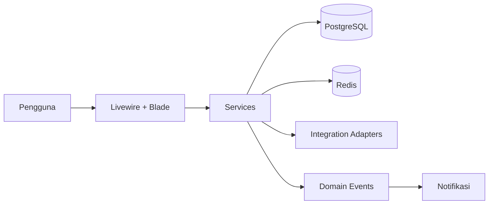

<div align="center">


# 🐾 PETORA

**Integrated Petshop & Pet Care Management System**

[](https://www.php.net/)
[](https://laravel.com)
[](https://livewire.laravel.com)
[](https://www.postgresql.org/)
[](https://redis.io/)
[](https://docs.docker.com/compose/)
[](LICENSE)

*Aplikasi web responsif untuk pengelolaan operasional petshop dan pet care — pelanggan, hewan, produk, stok, pembelian, POS, booking, grooming, klinik, rekam medis, farmasi, loyalty, promosi, keuangan, dan laporan — dengan dukungan multi-cabang.*

</div>

---

## 📑 Daftar Isi

- [✨ Fitur Utama](#-fitur-utama)
- [🛠️ Tumpukan Teknologi](#-tumpukan-teknologi)
- [📋 Persyaratan](#-persyaratan)
- [🚀 Instalasi](#-instalasi)
- [🧪 Pengujian](#-pengujian)
- [📁 Struktur Proyek](#-struktur-proyek)
- [📦 Modul (31 modul)](#-modul-31-modul)
- [🔍 Detail Modul](#-detail-modul)
- [🤝 Kontribusi](#-kontribusi)
- [📄 Lisensi](#-lisensi)

---

## ✨ Fitur Utama

- **POS & Penjualan** — kasir, pembayaran multi-metode, refund, idempotency key.
- **Stok** — `stock_movements` append-only, FEFO/FIFO, saldo per cabang.
- **Klinik & Rekam Medis** — kunjungan, diagnosis, revisi, visibilitas ke pemilik hewan.
- **Booking & Grooming** — cek kapasitas dengan lock, jadwal groomer.
- **Loyalty & Promosi** — poin dari nilai setelah diskon, kupon, program promosi.
- **Keuangan & Akuntansi** — kas, transaksi, laporan.
- **RBAC** — peran dinamis, 2FA, scope data per cabang.
- **Portal Pelanggan** — akses data sendiri (read-only, item `visible_to_owner`).
- **Integrasi** — adapter pihak ketiga terenkripsi di database.

---

## 🛠️ Tumpukan Teknologi

| Layer | Teknologi |
|---|---|
| Backend | PHP 8.3, Laravel 11 |
| Frontend | Livewire 3, Alpine.js, Tailwind CSS 3.4 |
| Database | PostgreSQL 16 |
| Cache/Queue/Session | Redis 7 |
| Infrastruktur | Docker, Docker Compose v2, Caddy, Nginx + php-fpm |
| PDF/Excel | dompdf, maatwebsite/excel |
| RBAC/2FA | spatie/laravel-permission, pragmarx/google2fa-laravel |
| Testing | Pest, Larastan (level 6), Laravel Pint |

---

## 📋 Persyaratan

- PHP 8.3+ & Composer
- Node.js 20+ & npm
- PostgreSQL 16 & Redis 7 (atau Docker)

---

## 🚀 Instalasi

### Lokal

```bash
git clone https://github.com/<org>/petora.git
cd petora
composer install
npm install
cp .env.example .env
# Set unique local PostgreSQL/Redis values in .env; never reuse development
# credentials in production and keep production values in a secret manager.
php artisan key:generate
php artisan migrate
php artisan db:seed
php artisan petora:bootstrap-admin
npm run build
php artisan serve
```

The bootstrap command is interactive, accepts a strong password without putting
it in shell history, and refuses to run once any user exists. The first
Super Admin login requires 2FA enrollment.

Production startup requires explicit PostgreSQL credentials and a CA certificate
with full TLS verification, encrypted/secure session cookies, authenticated TLS
Redis, an HTTPS application URL, and authenticated TLS SMTP. Missing or insecure
production settings cause the application to fail fast.

### Docker

Set `POSTGRES_DB`, `POSTGRES_USER`, and a unique `POSTGRES_PASSWORD` in the
environment before starting dependency containers. Ports are bound to loopback.

```bash
docker compose up -d postgres redis
```

---

## 🧪 Pengujian

```bash
php artisan test
./vendor/bin/pint --test
```

CI runs the suite against both SQLite and PostgreSQL 16. The deployment and
rollback scripts intentionally fail until a real release target and rollback
procedure are configured; they must not be treated as successful deployments.

---

## 📁 Struktur Proyek

```
app/
├── Modules/        # modul bisnis (Services, Livewire, Policies, Queries, Requests)
├── Integrations/   # adapter pihak ketiga
├── Contracts/
└── ...
database/
├── migrations/
└── seeders/
resources/
├── views/
└── lang/id/
docs/
├── ADR/
└── runbook/
```

---

## 📸 Cuplikan Layar

| Dashboard | POS | Rekam Medis |
|---|---|---|
|  |  |  |

> Ganti file di `docs/screenshots/` dengan tangkapan layar aktual.

---"

## 💡 Mengapa PETORA?

- **Satu sistem, seluruh operasional** — dari kasir hingga rekam medis dalam satu platform.
- **Multi-cabang sejak awal** — setiap transaksi membawa `branch_id`, siap berkembang.
- **Audit & keamanan** — 2FA, RBAC, enkripsi data medis, audit log lengkap.
- **Stok akurat** — append-only movement, FEFO/FIFO, lock transaksi.
- **Tanpa SPA** — Livewire + Alpine, lebih ringkas, lebih cepat dibangun.

---

## 🏗️ Arsitektur



---

## 📦 Modul (31 modul)

| # | Modul | Rilis | Ringkasan |
|---|---|---|---|
| 7.1 | Dashboard | R1 | KPI harian, grafik penjualan, notifikasi stok & kedaluwarsa. |
| 7.2 | User Management | R1 | Pengelolaan pengguna, status, cabang akses. |
| 7.3 | Role & Permission | R1 | Peran dinamis, permission, data scope. |
| 7.4 | Branch Management | R1 | Cabang, gudang, kas, konfigurasi per cabang. |
| 7.5 | Customer Management | R1 | Data pelanggan, riwayat, poin. |
| 7.6 | Pet Management | R1 | Hewan peliharaan, vaksinasi, alergi. |
| 7.7 | Product, Inventory, Warehouse | R1 | Produk, varian, batch, stok, gudang. |
| 7.8 | POS & Sales | R1 | Kasir, pembayaran, refund, void. |
| 7.9 | Purchasing & Supplier | R1 | PO, penerimaan, retur pembelian. |
| 7.10 | Grooming | R1 | Layanan grooming, jadwal, groomer. |
| 7.11 | Booking | R1 | Booking lintas modul, cek kapasitas. |
| 7.12 | Pet Hotel & Daycare | R2 | Kamar, check-in/out, tarif. |
| 7.13 | Transport | R2 | Antar-jemput hewan. |
| 7.14 | Home Grooming | R2 | Grooming di rumah pelanggan. |
| 7.15 | Veterinary Management | R1 | Dokter, jadwal, kunjungan. |
| 7.16 | Medical Records | R1 | Rekam medis, diagnosis, revisi. |
| 7.17 | Pharmacy & Medicine | R1 | Obat, resep, stok obat. |
| 7.18 | Membership | R2 | Paket membership, benefit. |
| 7.19 | Loyalty | R1/R2 | Poin dan reward. |
| 7.20 | Promotion | R1/R2 | Diskon, voucher, bundling, B1G1. |
| 7.21 | Staff Management | R1 | Data staf, jadwal, shift. |
| 7.22 | Attendance | R2 | Absensi, lembur. |
| 7.23 | Commission | R2 | Komisi staf/groomer. |
| 7.24 | Finance | R1 | Kas, transaksi, penutupan kas. |
| 7.25 | Accounting | R3 | Jurnal, COA, laporan keuangan. |
| 7.26 | Consignment | R3 | Barang titipan. |
| 7.27 | Reports & Analytics | R1 | Laporan penjualan, stok, keuangan. |
| 7.28 | Notification | R1 | Email/SMS/WA, template. |
| 7.29 | Customer Portal | R1 | Portal pelanggan (self-service). |
| 7.30 | System Settings | R1 | Pengaturan global, pajak, pembulatan. |
| 7.31 | Integration Settings | R1 | Kredensial integrasi terenkripsi. |

---

## 🔍 Detail Modul

### 7.1 Dashboard (R1)
- Omzet hari/minggu/bulan, total transaksi, pelanggan & hewan terdaftar.
- Booking hari ini, grooming berjalan, okupansi hotel (R2), stok menipis & mendekati kedaluwarsa.
- Pendapatan per jenis layanan, produk/layanan terlaris, grafik 7/30/90 hari, performa cabang lintas cabang.
- Cache 60 detik per cabang/pengguna; Super Admin filter cabang.

### 7.2 User Management (R1)
- Pengguna dinonaktifkan, tidak dihapus; tidak dapat menonaktifkan diri sendiri.
- Pengguna terakhir Super Admin aktif tidak dapat dinonaktifkan; tiap karyawan terhubung ke `employees`.
- Pengguna customer dibuat via registrasi portal atau staf.

### 7.3 Role & Permission (R1)
- Peran dinamis, permission, data scope (own/branch/all/assigned_records).

### 7.4 Branch Management (R1)
- Cabang nonaktif tidak menerima transaksi baru; minimal satu gudang per cabang.
- Setiap transaksi wajib `branch_id`; transfer stok antar cabang dicatat.

### 7.5 Customer Management (R1)
- Telepon dinormalisasi `62xxxxxxxxxx`, unik per organisasi; pencarian cepat (trigram).
- Blacklist: booking baru ditolak; transaksi kasir butuh persetujuan Admin.
- Data nonaktif tetap menyimpan riwayat medis & transaksi.

### 7.6 Pet Management (R1)
- Multi-pemilik via `pet_owners`, satu pemilik utama; perubahan pemilik utama oleh Admin/Super Admin tercatat.
- Hewan `deceased` tidak menerima booking baru; alergi/kondisi khusus tampil sebagai peringatan di layanan.

### 7.7 Product, Inventory, Warehouse (R1)
- Varian, harga (modal, jual, grosir, minimum, per cabang), import/export Excel, riwayat harga.
- Diskon tidak boleh di bawah harga minimum kecuali persetujuan Admin.
- Pergerakan stok: `purchase_in`, `sale_out`, `sale_return_in`, `purchase_return_out`, `adjustment_in/out`, `transfer_out/in`, `damage_out`, `lost_out`, `opname_adjust`, `service_consume_out`.
- Stock opname, transfer draft→sent→received, batas minimum, peringatan kedaluwarsa 60 hari, stock card.
- Tidak ada perubahan `stock_balances` tanpa `stock_movements`; lock baris; FEFO/FIFO.

### 7.8 POS & Sales (R1)
- Order status `draft → paid → completed → cancelled`; order `paid` tidak dapat diedit (koreksi via refund + order baru).
- Void sebelum pembayaran pertama (`pos.void`); refund butuh `pos.refund` + persetujuan.
- Retur produk membuat `sales_returns` + `stock_movements`; tutup kas dengan selisih; kas tertutup tidak dapat diubah.

### 7.9 Purchasing & Supplier (R1)
- PR (opsional) → PO → persetujuan → penerimaan parsial → invoice → pembayaran.
- Status PO lengkap; pencocokan 3 arah; penerimaan update harga modal rata-rata tertimbang.

### 7.10 Grooming (R1)
- Layanan, jadwal, groomer; buffer per layanan; tidak bertabrakan jadwal groomer (lock backend).
- Groomer hanya lihat jadwalnya (`assigned_records`); peringatan alergi saat check-in.

### 7.11 Booking (R1)
- Status `pending → confirmed → checked_in → completed → cancelled/no_show`.
- Booking portal masuk `pending` (konfirmasi staf/auto-confirm); kapasitas dicek dengan lock; reminder H-1 & 1 jam.

### 7.12 Pet Hotel & Daycare (R2)
- Kamar, check-in/out, tarif; reservasi tidak melebihi kapasitas pada tanggal manapun (lock).
- Check-out setelah `checkout_time` dikenakan biaya per jam; pemberian obat mengurangi stok obat & tercatat.
- Daycare kapasitas harian per cabang.

### 7.13 Transport (R2)
- Antar-jemput hewan dengan penugasan driver dan status perjalanan.

### 7.14 Home Grooming (R2)
- Grooming di rumah pelanggan dengan area layanan dan jadwal.

### 7.15 Veterinary Management (R1)
- Dokter, jadwal, kunjungan medis (`medical_visits`) status `draft`/`final`.

### 7.16 Medical Records (R1)
- Setelah `final` tidak dapat diubah; revisi membuat `medical_record_revisions` (snapshot, dokter, alasan, waktu).
- Customer hanya lihat item `visible_to_owner = true`; diagnosis & catatan internal dienkripsi; data medis tidak dihapus saat akun customer dinonaktifkan.

### 7.17 Pharmacy & Medicine (R1)
- Obat keras (`prescription`) hanya dikeluarkan berdasar resep final dokter; FEFO; `service_consume_out`.
- Obat bebas di POS ikut aturan produk biasa.

### 7.18 Membership (R2)
- Paket membership, benefit, masa berlaku.

### 7.19 Loyalty (R1/R2)
- Default 1 poin per Rp 10.000; 100 poin = Rp 10.000; dapat diubah Super Admin.
- Poin dari nilai setelah diskon, bukan pajak/biaya layanan; refund membatalkan poin; penukaran tidak membuat order negatif.

### 7.20 Promotion (R1/R2)
- Diskon, voucher, bundling, B1G1; promo tidak digabung kecuali `stackable`.
- Voucher dikonsumsi saat order dibayar; diskon tidak melewati harga minimum.

### 7.21 Staff Management (R1)
- Data staf, jadwal, shift, komisi.

### 7.22 Attendance (R2)
- Absensi, lembur, rekap.

### 7.23 Commission (R2)
- Aturan komisi aktif saat transaksi (snapshot rate/type); perubahan aturan tidak mengubah komisi lama; pembayaran setelah approval periode.

### 7.24 Finance (R1)
- Kas, transaksi, penutupan kas; pengeluaran di atas ambang butuh approval; setiap perubahan adalah `cash_movements`.

### 7.25 Accounting (R3)
- Jurnal seimbang (debit=kredit); jurnal posted tidak dapat dihapus (koreksi via jurnal pembalik); periode tertutup tidak menerima jurnal baru.

### 7.26 Consignment (R3)
- Barang titipan, penjualan konsinyasi, settlement supplier.

### 7.27 Reports & Analytics (R1)
- Laporan penjualan, stok, keuangan, kinerja cabang.

### 7.28 Notification (R1)
- Email/SMS/WA, template, reminder otomatis.

### 7.29 Customer Portal (R1)
- Self-service: booking, riwayat, rekam medis visible, poin.

### 7.30 System Settings (R1)
- Pengaturan global, pajak (PPN 11% on/off, mode harga), pembulatan, stok negatif.

### 7.31 Integration Settings (R1)
- Kredensial integrasi terenkripsi di database, dikelola Super Admin.

---

## 🤝 Kontribusi

1. Buat cabang `feature/<modul>-<deskripsi>` dari `develop`.
2. Ikuti Conventional Commits: `feat(pos): ...`, `fix(stock): ...`.
3. Pastikan Pint, Larastan, dan Pest lulus sebelum PR.
4. Satu commit satu perubahan logis.

---

## 📄 Lisensi

© 2026 PETORA INDONESIA. Seluruh hak cipta dilindungi undang-undang.

Perangkat lunak ini dilisensikan di bawah [MIT License](LICENSE). Seluruh hak cipta dimiliki oleh **PETORA INDONESIA**.

---

> Sumber kebenaran spesifikasi: `PETORA_MTS_v2.md`. Jika ada pertentangan, ikuti dokumen tersebut.
